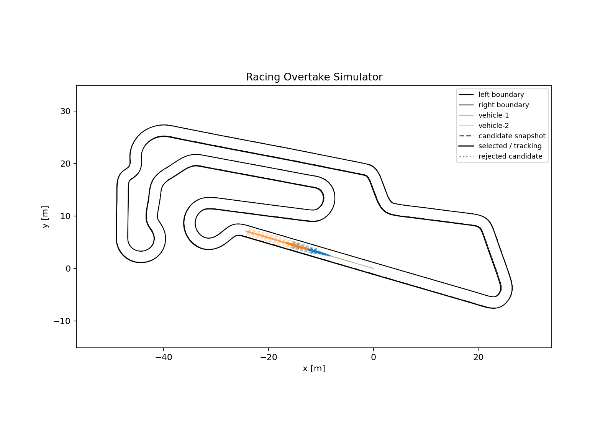

# 視覺化背景快取

> 後續發現：本測試略過 plt.pause，沒有涵蓋 TkAgg 視窗每幀 show 產生的完整重繪請求；
> 以下數值只支持無 GUI 條件。正式 GUI 路徑尚待修正，見 [後續追查](../2026-11-16_cache_comparison/README.md)。

日期：2026-11-16；分支：`master`；基於 `1955cacea110dc57ef6dfeea293a521e549f1b8e`，含未提交修改。
使用者要求：先實作背景快取，保持最小修改。

正式程式本次只改 `sim/visualizer.py`：即時模式且後端支援 blitting 時，快取 PNG 與座標軸，
後續還原快取並更新車輛、軌跡、候選、文字與圖例。賽道線條仍依原 zorder 重畫。
未修改 main.py、策略、控制器、模型步長或策略週期。
視窗尺寸、座標範圍、圖例變更及完整 draw 時重建快取；存圖使用完整繪製，
結束動畫後恢復正常顯示。不支援的後端沿用原流程。

## 實際驗證

```powershell
$env:MPLBACKEND="Agg"
$env:MPLCONFIGDIR="$PWD\.cache\matplotlib"
.\.venv\Scripts\python.exe -B reports/experiments/2026-11-16_background_cache/verify_cache.py
.\.venv\Scripts\python.exe -B -m unittest
```

現有 Python 3.10.20、NumPy 2.2.6、Matplotlib 3.10.9；沒有新增套件。
原雙車 relative_overtake＋progress 配置、Oschersleben 與 PNG、模擬 2 秒／100 步。
各案一次，Agg 無 GUI 等待；僅計圖元更新及渲染，不含策略計算，非實際 FPS。
對照組沿用圖元更新後完整 canvas.draw；快取組使用本次正式即時繪圖路徑。

| 項目 | 完整重繪 | 背景快取 |
| --- | --- | --- |
| 平均圖元更新＋渲染 | 141.37 ms／幀 | 8.38 ms／幀 |
| p95 | 150.20 ms | 8.28 ms |
| 首幀 | 173.47 ms | 166.15 ms |
| 第 2～100 幀平均 | 141.04 ms | 6.79 ms |
| 100 幀中的完整重繪次數 | 100 | 1 |

兩組最終車輛狀態逐值一致；第一幀仍需完整渲染。
完整數值與來源雜湊見 [summary.json](summary.json)。
本次完整 **299 項測試通過**，日誌見 [unittest.log](unittest.log)。
新增三項測試涵蓋快取重用、座標與尺寸變更、隱藏候選無殘影、存圖與完整重畫像素一致，
以及不支援後端的回退；其餘 296 項測試繼續執行。



已目視檢查存圖，未人工操作互動 GUI。GUI 排程與傳輸可能影響實際改善，
原有重新決策計算尖峰仍存在；未驗證長時間 GUI 效能或攻防安全性改善。
本次更新 README、CHANGELOG 與研究摘要；JSON、圖與日誌可納入 Git，尚未 commit／push。
原始地圖與環境仍為本機忽略檔。
