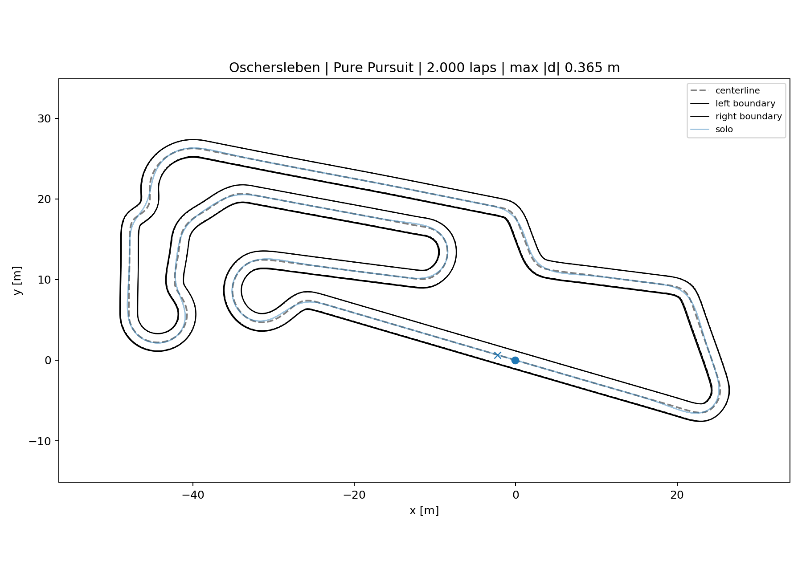

# 外部地圖接入與單車循跡驗證

> 歷史紀錄：以下為縮減前實際執行的版本與命令。單車入口、TrackSource 與額外 CLI 已撤回；目前使用方式見 [最小接入紀錄](../2026-11-16_map_minimal/README.md)。原數值與雜湊不回填；單車輔助程式保留於 reports/archive，僅供歷史追溯。

日期：2026-11-16；分支：`master`；基於 `1955cacea110dc57ef6dfeea293a521e549f1b8e`，含未提交修改。

使用者明確要求：實作下載地圖的接入、PNG 顯示，並確認單車能夠循跡。
本次沒有重訓 GP，也未驗證新賽道的多車攻防效果。

## 資料與方法

本機 `external/f1tenth_racetracks/` 為 Git 下載資料；本次讀取其 remote 為
`https://github.com/f1tenth/f1tenth_racetracks.git`，HEAD 為
`b95c4eff766f6367d66b310ea20cd2c9563712c0`，該資料倉庫的 `git status --short` 無輸出。
本次沒有連線更新來源。其 README 記載資料已縮為 F1TENTH 尺度，CSV 直接以公尺使用。

- `core/track_loader.py` 讀取中心線四欄 CSV，移除連續重複點及重複終點，再沿閉合折線弧長重採樣；保留起點與行進方向，不旋轉或縮放座標。
- 本批 23 圖均為固定對稱半寬 1.1 m，以 `Track.width=2.2` 接入；目前拒絕變寬及不對稱路寬，避免誤用固定寬度邊界。
- `sim/map_background.py` 依扁平 YAML 的 resolution、origin x/y/yaw 顯示 PNG。影像上列對應世界座標較高的 y；支援原點 yaw 旋轉，影像不參與策略、Pure Pursuit 或碰撞檢查。
- 單車直接循跡共享中心線，沿用既有 Pure Pursuit 與後軸運動學自行車模型；單車模式不載入 GP。外部圖多車模式也停用舊圖的 s→d GP，並顯示停用原因。

## 實際執行

工作目錄為專案根目錄；使用原有 NumPy 2.2.6、Matplotlib 3.10.9，沒有新增依賴。
原 `.venv` 指向已不存在的 Python 3.10 安裝路徑，現將其 `pyvenv.cfg` 改指向專案內現成的
`.cache/python/cpython-3.10.20-windows-x86_64-none/`，啟動後確為 Python 3.10.20。
原設定備份於 `.cache/pyvenv_before_map_import.cfg`；環境與備份均為 Git 忽略檔。

```powershell
$env:PYTHONNOUSERSITE="1"
$env:PYTHONDONTWRITEBYTECODE="1"
$env:MPLCONFIGDIR="$PWD\.cache\matplotlib"
$env:MPLBACKEND="Agg"
.\.venv\Scripts\python.exe -B main.py --track Oschersleben --single-vehicle --laps 2 --speed 5 --no-show --output reports/experiments/2026-11-16_map_import/oschersleben
.\.venv\Scripts\python.exe -B reports/experiments/2026-11-16_map_import/verify_maps.py
.\.venv\Scripts\python.exe -B -m unittest
```

第一個輸出目錄已存在，重跑需換成新的專案內路徑；程式拒絕覆寫既有結果。
完整測試的 stdout／stderr 經 Python subprocess 收集，保存於 [unittest.log](unittest.log)，
命令與退出碼見 [test_status.json](test_status.json)。

## 單車設定與量化結果

| 項目 | 實際設定／結果 |
| --- | --- |
| 賽道 | Oschersleben；CSV 重採樣上限間距 0.4 m、652 點、閉合折線長 260.632233 m |
| 路寬 | 2.2 m；左右各 1.1 m |
| 車輛 | 1 台；起始 s=0、d=0、速度 0；初始航向依前方 0.05 m 中心線計算 |
| 控制與模型 | Pure Pursuit 前視距離 2 m、目標速度 5 m/s；軸距 0.33 m、步長 0.02 s |
| 車身 | 實體長 0.55 m、寬 0.30 m、後軸到車身中心 0.12 m |
| 停止條件 | 累積進度至少 2 圈；模擬時間上限 300 s |
| 完成圈數／前進距離 | 2.00024249 圈／521.327667 m |
| 模擬時間／步數 | 104.44 s／5222 步；含初始狀態共 5223 個檢查樣本 |
| 後軸參考點最大 \|d\|／RMS | 0.364692 m／0.090011 m |
| 車身角點最大 \|d\| | 0.509504 m |
| 參考點／車身角點越界樣本 | 0／0；每步將四個實體角點投影到 CSV 邊界檢查 |

完整設定、來源 CSV／YAML／PNG 雜湊、程式雜湊與環境見 [summary.json](oschersleben/summary.json)。
[trajectory.csv](oschersleben/trajectory.csv) 每 10 步及最後一步保留狀態；上述誤差與越界統計使用全部步驟。
[centerline.csv](oschersleben/centerline.csv) 保存本次實際使用的中心線，避免用後續預設設定推測本次幾何。



## 其他檢查與限制

- **靜態檢查：**[map_inventory.json](map_inventory.json) 記錄 23 圖載入後的點數、長度、路寬、來源雜湊及 PNG 對齊。每張圖的全部重採樣中心線點皆落在影像範圍內，且對應亮度 >0.8 的像素；不代表車身或整個路寬均符合 PNG，也不是所有地圖的循跡實驗。
- **即時更新：**以 Agg 執行單車即時更新流程 2 秒，包含每 10 步更新及最終幀共 11 幀，背景皆只有一個圖元；時間上限到達時正確回報未完成圈數。見 [live_check.json](live_check.json)。
- **測試：**本次完整執行 299 項測試全部通過。先前已知的防守整合初始化錯誤仍在第一輪完整測試重現；將該回歸測試的參考路徑固定為 6 m，以覆蓋既有 6 m 過渡後通過，未修改正式策略參數。
- **預設入口：**另以 Agg 執行未帶參數的 `python main.py`，原有 21 秒、多車 GP 場景完成且退出碼為 0，見 [default_scene.log](default_scene.log)。結尾呼叫 `plt.show()` 時出現 Agg 無法顯示互動視窗的預期警告，未測試 GUI；此檢查只確認既有入口可執行，不是攻防效果比較。
- **目視觀察：**已檢視 Agg 輸出的圖檔，PNG 道路輪廓、CSV 中心線與行駛軌跡對齊；沒有人工操作互動 GUI。
- **結論範圍：**結果支持本次 Oschersleben、5 m/s、指定車身與控制參數下完成單車兩圈，離散檢查未發現超出 CSV 路寬。未驗證更高速、其他地圖、多車超車、GP、連續時間車身掃掠或 PNG 障礙物碰撞；沒有量測策略成功率。

## Git 與重現需求

本目錄的小型 JSON、CSV、圖與日誌可納入 Git，但本次未自動 commit／push。
來源程式雜湊、文件證據連結與忽略規則核對結果見 [handoff_checks.json](handoff_checks.json)。
原始地圖與本機虛擬環境仍被忽略；其他機器必須取得上述來源版本及相同地圖檔，
才能重現 PNG 顯示與原始 CSV 載入。已保存的中心線與結果圖可供離線查看，不包含全部原始地圖。
