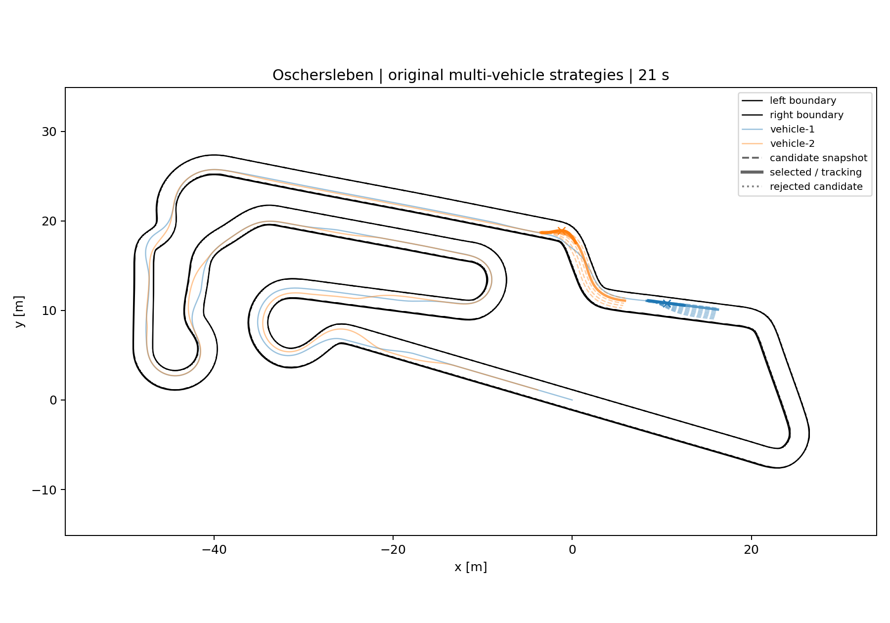

# 地圖接入縮減為最小必要修改

日期：2026-11-16；分支：`master`；基於 `1955cacea110dc57ef6dfeea293a521e549f1b8e`，含未提交修改。
使用者要求：保持最小調整，避免更動原有架構與程式碼。

本次撤回單車模式、附加 CLI、正式程式內的實驗匯出工具，以及 TrackSource／訓練資料格式擴充。
`Track`、`training_data/io.py` 與其既有測試已恢復為本次開發前版本，原有
`create_demo_track()`、`run_simulation()` 簽名及命令列入口也恢復。
策略、控制器、車輛模型與車輛／策略配置均未修改。

正式程式只在 `core/track_factory.py` 加入外部圖分支、在 `main.py` 組裝背景及停用不適用的舊 GP，
並在 `sim/visualizer.py` 接收可選背景；另有 CSV 載入與 PNG 顯示兩個小模組。
相對原始版本，main.py 為約 30 行的接入差異，factory 約 5 行，visualizer 約 11 行。
保留已完成的 6 m 防守回歸測試路徑修正，僅影響測試場景，沒有改正式策略參數。

使用方式仍是將 `main.py` 的 `TRACK_NAME` 改為 `"Oschersleben"`，執行 `python main.py --realtime`。
原本的 `VEHICLE_SPECS`、`STRATEGY_ASSIGNMENTS` 繼續決定多車競速。

## 本次驗證

```powershell
$env:MPLBACKEND="Agg"
$env:MPLCONFIGDIR="$PWD\.cache\matplotlib"
.\.venv\Scripts\python.exe -B reports/experiments/2026-11-16_map_minimal/verify_multivehicle.py
.\.venv\Scripts\python.exe -B -m unittest
```

以原有兩車 relative_overtake＋progress 配置、原有速度及起始 s，執行 21 秒／1050 步。
完整設定、程式雜湊見 [summary.json](summary.json)，實際輸出含碰撞紀錄見
[simulation.log](simulation.log)，測試結果見 [unittest.log](unittest.log)。
本次完整執行 296 項測試全部通過；撤回功能的 3 項測試已移除，既有功能測試繼續執行。
此場有偵測到 vehicle-1／vehicle-2 碰撞；只確認接入可執行，未宣稱策略效果改善。
使用 Agg 保存 PNG，沒有人工操作 GUI；本次沒有重新跑單車兩圈。



先前單車與多車測量保留原始數值和雜湊，屬於歷史版本；撤下的單車輔助程式保留在
`reports/archive/2026-11-16_track_following.py`，不由正式程式匯入，也不保證相容目前介面。
沒有移動或刪除原始地圖；原始地圖與環境仍為本機忽略檔，本次程式與小型證據尚未 commit／push。
