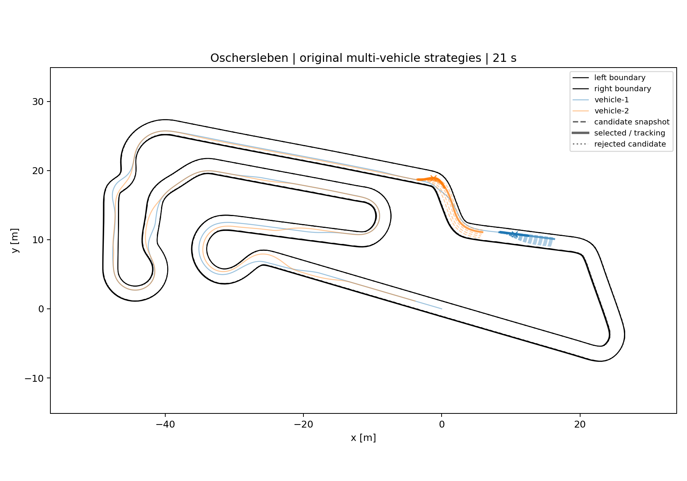

# 下載地圖接入原有多車競速入口

> 歷史紀錄：以下為縮減前實際執行的版本與命令。單車入口、TrackSource 與額外 CLI 已撤回；目前使用方式見 [最小接入紀錄](../2026-11-16_map_minimal/README.md)。原數值與雜湊不回填；單車輔助程式保留於 reports/archive，僅供歷史追溯。

日期：2026-11-16；分支：`master`；基於 `1955cacea110dc57ef6dfeea293a521e549f1b8e`，含未提交修改。

使用者明確要求：讓原有架構多一個可選地圖，能沿用既有多車競速策略執行。

## 修改與使用方式

`main.py` 現在只需設定 `TRACK_NAME="Oschersleben"`，再執行原有的 `python main.py --realtime`。
已移除頂端 `TRACK_SOURCE` 設定，依圖名自動選擇內建幾何或下載的 CSV／PNG；
`VEHICLE_SPECS`、`STRATEGY_ASSIGNMENTS`、時間設定、獨立策略狀態與 Pure Pursuit 均沿用原有架構。
CLI 的 `--track` 仍可單次覆寫圖名，單車模式保留作為額外驗證工具。
多車模擬與訓練資料收集共用這個選圖入口。

舊圖的 s→d GP 不適用新圖，外部圖沿用原有幾何對手預測，啟動時顯示停用原因，
並隱藏未使用的 GP 圖例；此限制沒有更改競速策略成本或候選選擇邏輯。

## 本次實際驗證

```powershell
$env:MPLBACKEND="Agg"
$env:MPLCONFIGDIR="$PWD\.cache\matplotlib"
.\.venv\Scripts\python.exe -B reports/experiments/2026-11-16_map_multivehicle/verify_multivehicle.py
.\.venv\Scripts\python.exe -B -m unittest
```

驗證程式僅覆寫 `main.TRACK_NAME` 並將最終畫面存檔，以無參數的 `run_simulation()` 執行。
使用現有 `.venv`、Python 3.10.20、NumPy 2.2.6、Matplotlib 3.10.9，沒有新增套件。

- Oschersleben；重採樣 652 點、路寬 2.2 m、閉合中心線長 260.632233 m。
- 原有 21 秒、步長 0.02 秒；2 台車各 1050 步，含初始狀態各 1051 筆。
- `vehicle-1` 使用 `relative_overtake`，起始 s=0、目標速度 11 m/s，模型速度上限仍為 10 m/s。
- `vehicle-2` 使用 `progress`，起始 s=4 m、目標速度 9 m/s；兩車均由靜止出發。
- 前進距離分別為 207.0822 m 與 186.8929 m；後軸參考點最大 |d| 分別為 0.8641 m 與 0.8057 m。
- **有偵測到 `vehicle-1/vehicle-2` 碰撞**，進攻策略曾進入 `NO_FEASIBLE_PATH`。本次沒有修正攻防策略、調整其成本或將此場景描述為無碰撞通過；沒有統計碰撞次數或成功率。
- 完整執行 **299 項測試全部通過**，包含只改 `TRACK_NAME` 的多車入口、三車 ID、GP 停用及資料收集共用圖形的檢查。

設定與程式雜湊見 [summary.json](summary.json)，實際策略轉換及碰撞輸出見
[simulation.log](simulation.log)，完整測試見 [unittest.log](unittest.log)。
已目視檢查下圖；採 Agg 產圖，沒有人工操作互動 GUI。



## 限制與交接

單場執行只證明入口、策略與顯示可在新圖運作，不代表安全性或超車效果改善。
21 秒未完成此賽道整圈，本次沒有重新測量完整車身越界；原有單車兩圈證據見
[先前紀錄](../2026-11-16_map_import/README.md)，其程式雜湊保留當時版本，不回填後續改動。

本次程式與小型證據尚未 commit／push；下載地圖、本機 `.venv` 仍為忽略檔。
原始 CSV／PNG 的來源版本及雜湊沿用先前地圖盤點，不隨本次小型證據上傳。
