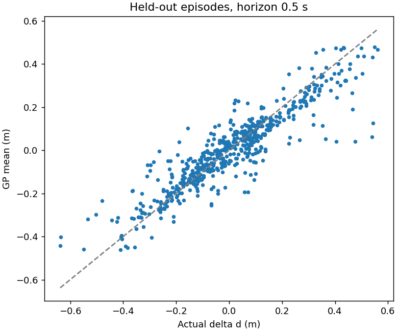

# 互動 GP 第一階段

日期：2026-11-17；分支 master；基於 `6dc4a2b9cb76c5f83810efadeeb3a0eca0d75968`，含未提交修改。
使用者要求實作資料收集、七項狀態輸入、0.5 s 前車橫向位移預測與離線比較。

## 方法與設定

`interaction_gp.py` 重用正式 `run_episode()`，可選 step_observer 保存後車控制前狀態所對應的決策與實際命令。
原始狀態 50 Hz，樣本 10 Hz，答案為前車 d(t+0.5)−d(t)。
七項輸入為 gap（前車 s−後車 s）、rear_d、front_d、relative_speed（後車−前車）、front_speed、
front_lateral_speed（過去 0.1 s 差分）、front_curvature（中心線前後 0.5 m 三點估計）。
gap 為短距最短有號車距，與舊 relative_s 符號相反。後車動作僅供診斷，不使用前車內部決策作輸入。

圓角矩形、20 場各 15 s、seed=42，前車 defend、後車 probe_follow；
初距 2～5 m、起點取整圈位置、前車巡航 3～7 m/s、後車巡航為前車＋2 m/s，交替靜止／移動中起步。
防守配置固定，試探順序仍固定左、回中、右、回中；未實作左右起始順序隨機化。
完整賽道、實際初始條件與配置見 [data_metadata.json](data_metadata.json)。

沿用 StandardScaler、ConstantKernel×RBF+WhiteKernel、normalize_y=True、optimizer_restarts=0。
按 episode 切成 12 場訓練、4 場驗證、4 場測試；訓練池 1740 筆，固定 seed 抽 800 筆擬合。
驗證與測試各 580 筆，未依驗證或測試結果調參；scaler 僅由實際擬合的 800 筆建立。

## 實際命令

```powershell
$env:OPENBLAS_NUM_THREADS='1'
.\.venv\Scripts\python.exe interaction_gp.py collect --episodes 20 --seconds 15 --output data/training/interaction_phase1
$env:OMP_NUM_THREADS='1'
.\.venv\Scripts\python.exe interaction_gp.py train --data data/training/interaction_phase1 --max-train 800 --output models/gp/interaction_phase1
```

目錄已存在，重跑須使用新目錄。預設 seed=42。
原始狀態 30040 列、後車動作 15000 列，原始狀態沒有碰撞紀錄。
有效樣本 2900 筆；排除 20 筆無歷史與 100 筆未來不足。
樣本模式：follow 312、probe_left 941、probe_right 553、return 1094，左右仍不均衡。
模式是決策階段，不代表車輛已到達該側。

## 量測結果

| 模型 | 測試 MAE（m） | 測試 RMSE（m） |
| --- | ---: | ---: |
| GP | 0.059223 | 0.086608 |
| 固定 Δd=0 | 0.160928 | 0.206536 |
| 延續當下橫向速度 | 0.165610 | 0.215389 |

驗證 GP MAE／RMSE 為 0.045539／0.061063 m。
測試直線 MAE 0.066026 m、彎道 0.047588 m；左試探模式 0.075231 m、右試探 0.044605 m。
兩倍標準差實際涵蓋率 89.14%，低於常態分布約 95% 的參考值；尚未校準，不能作安全界線。
無 kernel 擬合警告，大位移仍有明顯誤差。



`.\.venv\Scripts\python.exe -m unittest`：342 項通過，34.024 s，見 [unittest.log](unittest.log)。
補充事件輸出與模型 metadata 後，另執行 `-m unittest tests.test_interaction_gp`，5 項通過。
涵蓋特徵不看未來、標籤對齊與碰撞排除、整場切分、訓練限定 scaler、模型重讀及事件保存。

## 證據與限制

[report.json](report.json) 保存切分、樣本索引、版本、kernel 及分情境誤差；
[predictions.csv](predictions.csv) 保存驗證／測試答案，[events.csv](events.csv) 保存目標切換、首次到達及不可行事件，
[source_hashes.json](source_hashes.json) 保存關鍵工作區檔案雜湊。
這是單一地圖、固定防守配置下的離線預測；不同防守者、試探順序、雜訊及跨地圖尚未驗證。
尚未實作動作條件式模型、完整未來軌跡、規劃器接入或安全 fallback。
原始資料 `data/training/interaction_phase1/` 與模型 `models/gp/interaction_phase1/model.pkl` 受 .gitignore 排除，僅在本機。
本目錄小型證據可納入 Git；本次未 commit／push。
