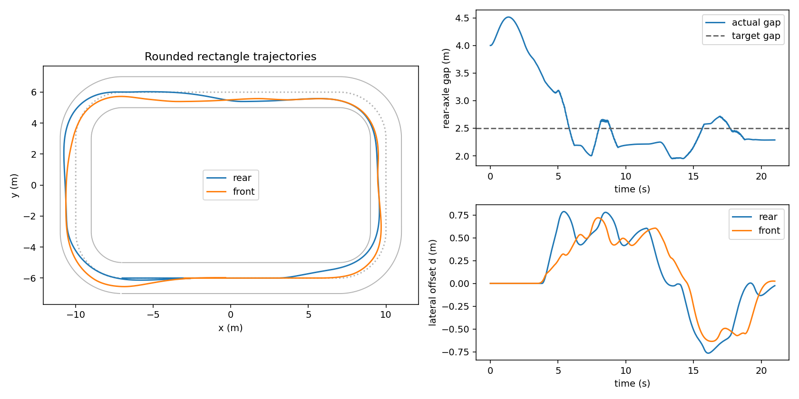
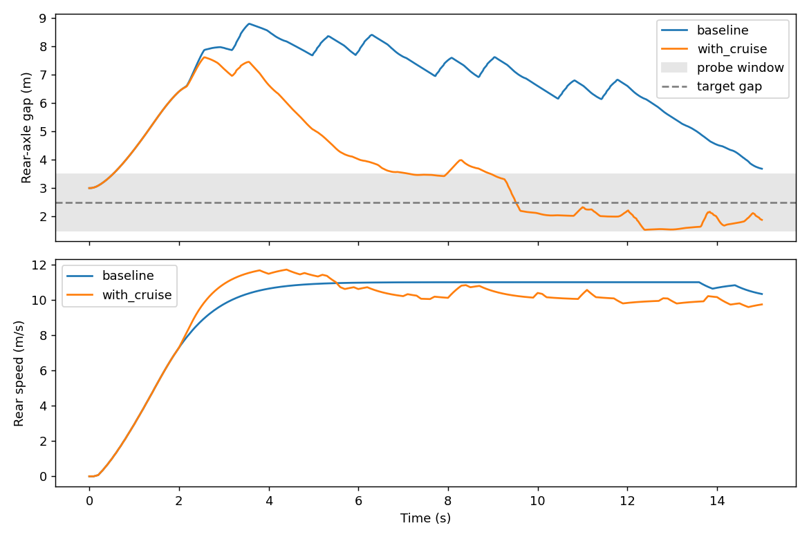
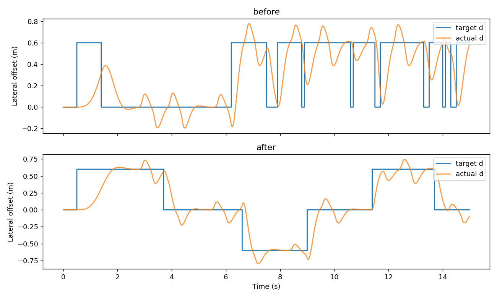

# 圓角矩形試探跟車驗證

日期為 2026-11-17，分支為 `master`。
基於 `6dc4a2b9cb76c5f83810efadeeb3a0eca0d75968`，含未提交修改。

使用者明確希望後車追隨前車、左右嘗試超車並觀察防守反應，作為 GP 互動學習的資料來源。
使用者將原先的前車速度上限提案更正為目標相對進度成本，並要求開始實作及先以圓角矩形簡單測試。
本次實作選擇為獨立的 `probe_follow` 策略與 `--probe-follow` 示範入口。

## 實作方式

策略位於 `strategy/probe_following.py`，透過共用 `StrategyDecision` 回傳 maneuver 與 speed_limit。
`main.py` 及 `sim/data_generation.py` 註冊工廠，每台車持有獨立策略狀態。
資料生成入口會複製策略配置、保存參數，並支援選擇 probe_follow 車輛的資料配對。

每輪評估回中、上一個橫向目標與本次試探目標，搭配前車當下速度減去 1、相同速度、加上 1 m/s。
速度要求被限制在 0 與原巡航目標之間，重複的橫向目標及速度要求會去除，每輪最多九個候選。
後車巡航上限高於前車時，可選擇追近候選。

所有自車候選都從同一狀態，以相同 dt、模型、控制器與視野 rollout。
所有其他車每輪各預測一次，採用既有的定速、等 d bicycle 預測，供自車候選共用。
實際前車仍讀取後車位置並執行既有防守策略。

每次試探鎖定同一前車，間距沿用 `RelativeTargetState` 的累積進度表示法，跨起終點保持連續。
車距落在目標 ±1 m 時啟動「左、回中、右、回中」循環。
當實際 d 在本階段目標 ±0.1 m 內，開始計時並連續保持 1 s，才切換下一階段。
重新評估同一橫向目標時，沿用原 maneuver 起點。

## 成本與硬性剔除

令 k 為候選預測取樣索引，N 為最後索引，qR、qF 分別為後車與前車從本輪起點累積的賽道進度。
後軸間距為 `g[k] = g[0] + qF[k] - qR[k]`，單位 m，目標 `g* = 2.5 m`。
前車與後車步長不同時，前車進度與車身投影界限會插值到自車取樣時間。

```text
u_rel = ((qR[N] - qR[N-1]) - (qF[N] - qF[N-1])) / (t[N] - t[N-1])

J_gap    = w_gap    × mean(((g[1:N+1] - g*) / L_gap)^2)
J_speed  = w_speed  × (u_rel / L_speed)^2
J_probe  = w_probe  × ((d[N] - d_probe) / L_d)^2
J_switch = w_switch × ((target_d - previous_target_d) / L_d)^2
J_total  = J_gap + J_speed + J_probe + J_switch
```

`u_rel` 的單位為 m/s，以最後一段進度差計算。
`d[N]` 為後車預測終點經座標投影所得的橫向偏移，`d_probe` 為本階段希望到達的橫向位置。
正規化尺度為 `L_gap=1 m`、`L_speed=1 m/s`、`L_d=0.6 m`。
權重依序為 2、1、2、0.5，四項成本皆無量綱，取總成本最小的可行候選。

碰撞與不超越是評分前的硬性剔除條件。
每個預測取樣都使用既有矩形碰撞檢查，並要求後軸間距大於 0。
將前車及後車的四個實體車身角點投影到賽道，計算前車車尾與後車車頭的縱向投影留距，
任何取樣小於 0.3 m 就剔除，即使兩車因橫向分離而沒有車身碰撞也適用。
被剔除的候選保留原因與預測狀態，成本項目為空。
全部被剔除時記錄 `no_feasible_path`，沿用前一決策並重設保持計時。

## 實際執行與量化結果

以下命令從 repo 根目錄執行。

```powershell
.\.venv\Scripts\python.exe reports/experiments/2026-11-17_probe_following/verify.py
```

腳本以正式 `run_episode()` 閉迴路前進兩車，記錄包裝呼叫原本的策略與步進函式並原樣回傳結果。
場景使用中心線跨度 20 × 12 m、彎道半徑 3 m、路寬 2 m、500 點的圓角矩形，一圈約 58.85 m。
兩車皆由靜止起步，後車 s=0、前車 s=4 m，巡航目標分別為 4 與 3 m/s。
前車使用 `defend`，對象為後車，防守的碰撞檢查開關沿用此場景的 False。
自車規劃仍執行所有對手的預測碰撞剔除。

模型 dt 為 0.02 s，策略週期為 0.1 s，視野為 1 s。
Pure Pursuit 前視距離 2 m、速度增益 1.5 s⁻¹、加減速上限各 5 m/s²，車輛速度上限為 30 m/s。
車身尺寸為 0.55 × 0.30 m，既有碰撞矩形為 0.60 × 0.40 m。
完整設定保存在 [summary.json](summary.json)，其中 controller_config 為共用模板，各車巡航目標由 scenario 的 target_speed 套用。

| 量測項目 | 實測結果 |
| --- | --- |
| 模擬時間／步數 | 21 s／1050 步 |
| 候選評估次數 | 210 次，含初始規劃 |
| 起始／結束後軸間距 | 4.0000／2.2878 m |
| 全程後軸間距範圍 | 1.9490～4.5150 m |
| 最後 5 秒相對於 2.5 m 的車距 MAE | 0.1565 m |
| 最小實際車身縱向投影留距 | 1.3758 m |
| 後車高於前車速度 0.05 m/s 的步數 | 326 |
| 後車負加速度步數 | 320 |
| 後車實際 d 範圍 | −0.7643～+0.7871 m |
| 前車實際 d 範圍 | −0.6349～+0.7197 m |
| 後車累積圈數 | 1.0743 圈 |
| 實際車身碰撞配對 | 空集合 |
| 新決策第一步的預測／執行最大絕對差異 | 0 |

實際模式包含 follow、probe_left、return、probe_right，未出現 no_feasible_path。
這個案例有完成追近、左右試探及前車的左右防守，且所有實際取樣均保持車身縱向留距。
車距及橫向位置仍有波動，±0.6 m 是試探目標，實際偏移曾達約 ±0.78 m。
量化結果見 [summary.json](summary.json)，逐步資料見 [trace.csv](trace.csv)。

正式入口也以 Agg 執行 `python main.py --probe-follow` 完成 21 s，exit code 為 0。
左側試探於 3.80 s 開始，11.50 s 回中，13.70 s 進入右側試探，17.70 s 再回中，
前車有左右防守動作且未回報碰撞，輸出見 [main_agg.log](main_agg.log)。



`trace.csv` 每列為決策當下、步進前的同步雙車狀態，搭配該步實際執行的目標與加速度。
包含時間、模式、評估時間、間距、車身留距、雙車 s/d/x/y/yaw/速度、target_d、speed_limit 及四項成本。
模式表示本輪試探階段，實際選中並傳入控制器的橫向要求以 target_d 為準。
因此可對齊後續時間的前車反應，但本次尚未建立 GP 互動模型的訓練標籤或進行訓練。

## 測試與限制

新增 11 項回歸測試，涵蓋遠距追近、近距減速、成本公式、整段不超越、途中越界後返回的剔除、
橫移起點保持、實際到達與保持時間、跨起終點、前車鎖定、多車預測共享、輸入驗證、策略註冊及資料入口。
實際執行完整測試，329 項全部通過，輸出見 [unittest.log](unittest.log)。

```powershell
$env:MPLBACKEND='Agg'
$env:MPLCONFIGDIR=Join-Path (Get-Location) '.cache/matplotlib'
$env:TEMP=Join-Path (Get-Location) '.cache'
$env:TMP=$env:TEMP
.\.venv\Scripts\python.exe -m unittest tests.test_probe_following -v
.\.venv\Scripts\python.exe -m unittest -v
```

本機使用既有 Python 3.10.20 與 NumPy 2.2.6。
圖片以 Agg 保存並檢視，互動 GUI 本次未人工驗證。
目前量化結果僅涵蓋這個圓角矩形雙車場景，尚未驗證其他車速、初始條件或突發減速。
預測仍假設對手定速、等 d，與實際會防守的前車存在模型差異。
全部候選不可行時沿用前一決策，完整 fallback 與緊急煞車尚未實作。

新場景使用內建賽道與基本依賴即可重現。
本次程式、測試、CSV、JSON、圖表與日誌尚未 commit／push，GitHub 暫時無法讀取這批結果。

## 11/17 一般策略配置的入口修復

本次仍基於 `6dc4a2b9cb76c5f83810efadeeb3a0eca0d75968` 的 `master` 未提交工作區。
使用者提供一般 `main.py --realtime` 的 unregistered strategy name 錯誤後，檢查到 main.py
已有 probe_follow 指派，但匯入、PROBE_FOLLOWING_CONFIG 與 strategy_factories 的註冊均缺失。
本次補回該入口與圓角示範入口，並新增一般 STRATEGY_ASSIGNMENTS 的實際策略建立測試。

同時依配置中的防守／試探角色，將 vehicle-1 放在 s=4 m、vehicle-2 放在 s=0 m。
測試採用目前 Oschersleben 地圖、15 s，巡航目標為 vehicle-1 的 10 m/s 與 vehicle-2 的 12 m/s。
前文 21 s 圓角結果保留原紀錄，重現該歷史場景時需將 SIMULATION_SECONDS 設為 21。

實際執行以下命令，Matplotlib 後端設為 Agg。

```powershell
$env:MPLBACKEND='Agg'
$env:MPLCONFIGDIR=Join-Path (Get-Location) '.cache/matplotlib'
python -m unittest tests.test_probe_following -v
python -m unittest -v
python main.py --realtime
```

試探策略相關 12 項與完整 330 項測試均通過。
原有兩圈防守測試固定為自身的 21 s 場景，正式模擬仍採用目前 15 s 配置。
一般主程式完成 15 s，exit code 為 0，輸出未回報車身碰撞。
此趟 vehicle-2 全程維持 FOLLOW，車距未進入左右試探的觸發區間，沒有據此宣稱高車速試探效果。
互動 GUI 本次未人工驗證。

設定見 [registration_summary.json](registration_summary.json)，執行輸出見
[registration_main_agg.log](registration_main_agg.log)，完整測試見
[registration_unittest.log](registration_unittest.log)。
本次修復、測試與新增證據尚未 commit／push。

## 11/17 圓角矩形 10／12 m/s 的追近診斷

使用者觀察後車與前車保持遠距，詢問原因。
本次以當下 main 配置重現，分支 master，基於 `6dc4a2b9cb76c5f83810efadeeb3a0eca0d75968`，含未提交修改。
場景為圓角矩形、15 s，兩車從靜止起步，前車 s=3 m、巡航 10 m/s，後車 s=0 m、巡航上限 12 m/s。
策略類別的 target_gap 預設值為 1.5 m，但 main 明確傳入 2.5 m，因此本次實際目標為 2.5 m。

實際執行以下命令，只記錄真實策略與步進的原始輸入／輸出。

```powershell
.\.venv\Scripts\python.exe reports/experiments/2026-11-17_probe_following/diagnose_gap.py
```

| 時刻 | 後軸車距 | 前車實際速度 | 後車實際速度 |
| --- | --- | --- | --- |
| 0 s | 3.000 m | 0 | 0 |
| 1 s | 4.358 m | 5.000 m/s | 2.937 m/s |
| 3 s | 7.955 m | 9.737 m/s | 9.758 m/s |
| 10 s | 6.609 m | 10.000 m/s | 11.000 m/s |
| 15 s | 3.684 m | 10.000 m/s | 10.332 m/s |

全程車距最大為 8.805 m，未偵測到車身碰撞。
150 次評估有 139 次選中最快候選，模式為 6 次 probe_left 與 144 次 follow。
起步 t=0 選中速度要求 0，實際後車加速度亦為 0，對手的定速預測將當下靜止的前車視為未來繼續靜止。
之後前車實際加速，後車受「前車當下速度＋1 m/s」候選上限與比例控制的追蹤延遲影響，初期車距拉大。
前車接近 10 m/s 後，後車速度要求最高約 11 m/s，設定的 12 m/s 巡航上限沒有列為候選。

另在三個時刻，使用完全相同狀態、路徑、控制器、對手預測與硬性剔除條件，額外計算 12 m/s 候選。
這些額外候選僅供診斷，未傳入執行端，原閉迴路決策保持原樣。

| 評估時刻 | 原選中速度要求 | 原成本總和 | 額外 12 m/s 候選成本總和 | 視野內可行 |
| --- | --- | --- | --- | --- |
| 4 s | 10.943 m/s | 62.596 | 58.576 | 是 |
| 8 s | 11.000 m/s | 47.772 | 43.135 | 是 |
| 12 s | 11.000 m/s | 26.302 | 26.186 | 是 |

這三個取樣支持候選集合限制追近能力的分析，尚未量測執行 12 m/s 後的閉迴路結果。
試探啟動區間為實際目標 2.5 ± 1 m，車距在 0.6 s 超過 3.5 m 後回到 follow，結束時 3.684 m 仍在區間外。
因此本次有後段追近，但未在 15 s 內回到持續左右試探的距離。

完整設定與額外候選各項成本見 [gap_diagnosis_summary.json](gap_diagnosis_summary.json)，
逐次規劃見 [gap_diagnosis_decisions.csv](gap_diagnosis_decisions.csv)。
本次僅新增診斷與紀錄，未修改正式策略或重新執行完整單元測試。

Codex 分析／建議，未經使用者確認，待驗證。
優先考慮將原巡航速度加入追近候選，並保留速度匹配與減速候選，再驗證起步與彎道的車距收斂。
目標車距的操作設定應集中在 main 的 PROBE_FOLLOWING_CONFIG，避免類別預設值與明確傳入值造成理解差異。
本次診斷程式與證據尚未 commit／push。

## 11/17 加入原巡航速度候選

使用者同意先實作第一步：保留原有速度候選，加入後車原巡航速度，先比較追近效果。
分支為 `master`，基於 `6dc4a2b9cb76c5f83810efadeeb3a0eca0d75968`，含未提交修改。

### 實作

`strategy/probe_following.py` 的 `_speed_limits()` 保留前車當下速度 −speed_step、匹配、＋speed_step，
加上原巡航速度，以 0 與原巡航速度為上下限，維持原順序去重，每條既有橫向路徑最多四種速度。
例如前車 10 m/s、後車巡航 12 m/s，候選為 9、10、11、12 m/s。
新候選與其他候選使用同一預測、成本與硬性剔除流程，選中後仍連同 maneuver 傳到實際控制端。
本次未修改成本權重、預測視野、對手模型、碰撞條件或 main 的參數。

### 實際執行

以下路徑皆相對 repo 根目錄；採用 Agg 無畫面執行。

```powershell
.\.venv\Scripts\python.exe reports/experiments/2026-11-17_probe_following/compare_cruise.py
$env:MPLBACKEND='Agg'
$env:MPLCONFIGDIR=Join-Path $PWD '.cache/matplotlib'
$env:TEMP=Join-Path $PWD '.cache'
$env:TMP=$env:TEMP
.\.venv\Scripts\python.exe -m unittest 2>&1 | Tee-Object -FilePath reports/experiments/2026-11-17_probe_following/cruise_unittest.log
.\.venv\Scripts\python.exe main.py > reports/experiments/2026-11-17_probe_following/cruise_main_agg.log 2>&1
```

比較固定為前次診斷的 3 m 初距，前車 s=3、後車 s=0，兩車從靜止起步，巡航分別為 10／12 m/s。
圓角矩形中心線跨度 20×12 m、彎角半徑 3 m、路寬 2 m、500 點，dt=0.02 s、策略週期 0.1 s、預測 1 s。
目標後軸車距 2.5 m、試探區間 1.5～3.5 m；其他配置完整保存於 JSON。
前車使用原 defend，後車使用 probe_follow，baseline 僅於實驗中還原舊速度候選，其餘皆走正式 `run_episode()`。
兩組均反覆重規劃，沒有測試直接指定速度要求或加速度。

| 量測項目 | 舊候選 baseline | 加入巡航候選 |
| --- | ---: | ---: |
| 規劃次數 | 150 | 150 |
| 最大後軸車距 | 8.804679 m | 7.619618 m |
| 15 s 末距 | 3.684468 m | 1.877589 m |
| 離開試探區間後首次返回 | 15 s 內未返回 | 7.16 s |
| 選中原巡航 12 m/s 的次數 | 0 | 31 |
| follow 模式累積時間 | 14.4 s | 7.6 s |
| probe_left 模式累積時間 | 0.6 s | 7.4 s |
| 重規劃首步 x／y／yaw／velocity 最大絕對誤差 | 0 | 0 |
| 實際偵測車身碰撞 | 無 | 無 |
| 後軸進度超越前車樣本 | 0 | 0 |



此案例支持加入巡航候選能較快追回距離，但起步車距仍先擴大。
模式累積時間只代表策略所處階段，不代表已完成相應的橫向動作；本次 15 s 沒有完成左右試探循環。
起步的定速對手預測仍將靜止前車視為持續靜止，有限視野及全部候選不可行時沿用舊決策的限制仍存在。
以上單一場景的結果不提供自動避碰或安全 fallback 保證。

完整 334 項測試通過，exit code 0，耗時 23.385 s。
新增四項涵蓋遠距選巡航、速度去重與上限、巡航候選仍被禁止超越條件剔除，以及實際步進一致性。
修改前 probe_follow 測試已有三項失敗，原因是測試隱含 2.5 m 但類別預設已為 1.5 m；
本次讓這些測試明確設定 2.5 m，未改正式類別預設或 main 的目標車距。
PowerShell 日誌將 Python stderr 包成 NativeCommandError，測試末行為 OK、實際 exit code 為 0。

另外直接執行當下 `main.py`，其起始車距已是 1 m，與上表的固定 3 m 比較案例不同；
15 s 執行完成、exit code 0，未回報碰撞，模式出現 FOLLOW／PROBE_LEFT。
Agg 的 `plt.show()` 產生非互動後端警告，互動 GUI 未人工驗證。

證據：[比較設定與結果](cruise_comparison_summary.json)、[baseline 逐步紀錄](cruise_baseline_trace.csv)、
[加入巡航逐步紀錄](cruise_with_cruise_trace.csv)、[測試輸出](cruise_unittest.log)、[main 輸出](cruise_main_agg.log)。
本次程式、摘要、CSV、圖表及日誌尚未 commit／push，GitHub 尚無法讀取這些未提交結果。

## 11/17 試探目標保持

使用者觀察到偏出去後很快回中，希望停留久一點。
分支 `master`，基於 `6dc4a2b9cb76c5f83810efadeeb3a0eca0d75968`，含未提交修改。
本次沿用已加入巡航候選的程式，修改前後皆為當下 main 的圓角矩形、1 m 初距、兩車從靜止起步，
前車巡航 10 m/s、後車巡航上限 12 m/s，模擬 15 s；這與前節固定 3 m 初距的比較不同。
完整賽道、策略、模型與控制器配置保存於兩份 JSON，dt=0.02 s、決策週期 0.1 s。

### 原因與實作

原本 `hold_seconds=1` 只控制階段切換，每輪成本比較仍可選回中心線，
車距超出試探啟動區間也會要求回中，未形成「到達後維持目標」的行為。
新增每車獨立的 `phase_active`，啟動後鎖定本階段的橫向目標，在同一目標的可行速度候選中比較原成本。
其他路徑仍保留於快照，數值上的可行表示通過既有剔除條件，不代表保持階段允許選它。
若保持目標沒有可行候選，清除保持計時，允許原有其他可行路徑參與選取；全部不可行仍沿用既有 no_feasible_path 行為。
成本公式、權重、對手預測與碰撞條件未改。

main 與類別預設的 `hold_seconds` 改為 2 s，首次實際進入目標 ±0.1 m 時開始計時，
保持期間的一般追蹤誤差或車距波動不重置計時。
返回中心線也使用相同保持時間，完成回中後，下一次側向試探仍須車距進入 2.5±1 m。
這是目標保持時間，並非實際偏移必須連續位於 ±0.1 m 內的時間；候選不可行可提早中止。

### 命令與結果

修改前、後分別執行下列命令，使用正式 `run_episode()` 反覆重規劃；測試不直接指定速度或轉向。
`before` 是修改前工作區的量測，現在直接用新程式重跑 before 不會還原舊行為。

```powershell
.\.venv\Scripts\python.exe reports/experiments/2026-11-17_probe_following/verify_hold.py before
# 完成上述策略與保持時間修改後：
.\.venv\Scripts\python.exe reports/experiments/2026-11-17_probe_following/verify_hold.py after
```

| 量測 | 修改前 | 修改後 |
| --- | --- | --- |
| 非零橫向目標區段 | 9 段，全為左側 | 3 段，左、右、左 |
| 已完成區段的首次到達後目標保持時間 | 0.12～1.30 s，另有未到達／模擬結束截斷區段 | 2.06、2.08、2.02 s |
| 首段目標／首次到達／切換時刻 | 0.50 s／未到達／1.40 s | 0.50 s／1.64 s／3.70 s |
| 偵測碰撞 | 無 | 無 |
| no_feasible_path 步數 | 0 | 0 |

首次到達的 CSV 量測精度為 0.02 s，策略每 0.1 s 評估一次到達及切換，因此量測保持時間略高於 2 s。
修改後其他兩段為右側 6.60～9.00 s（6.92 s 首次到達），左側 11.40～13.70 s（11.68 s 首次到達）。



完整測試命令為 `.\.venv\Scripts\python.exe -m unittest`，Agg 環境、TEMP／TMP 指向 repo 的 `.cache`，
使用 Python subprocess 將 stdout／stderr 合併保存至 [hold_unittest.log](hold_unittest.log)。
新增三項回歸測試，覆蓋中心線成本較低時仍保持側向目標、車距／追蹤誤差波動不打斷計時、
該側不可行時允許其他路徑；既有到達後計時測試調整為 2 s，完整 337 項通過，耗時 23.479 s。

本次只量測這個雙車案例，彎道實際偏移仍有波動；未人工驗證 GUI，未建立安全 fallback 或自動避碰保證。
證據：[修改前設定與結果](hold_before_summary.json)、[修改後設定與結果](hold_after_summary.json)、
[修改前逐步紀錄](hold_before_trace.csv)、[修改後逐步紀錄](hold_after_trace.csv)、[驗證程式](verify_hold.py)。
本次修改與證據尚未 commit／push，GitHub 無法讀取未提交結果。
