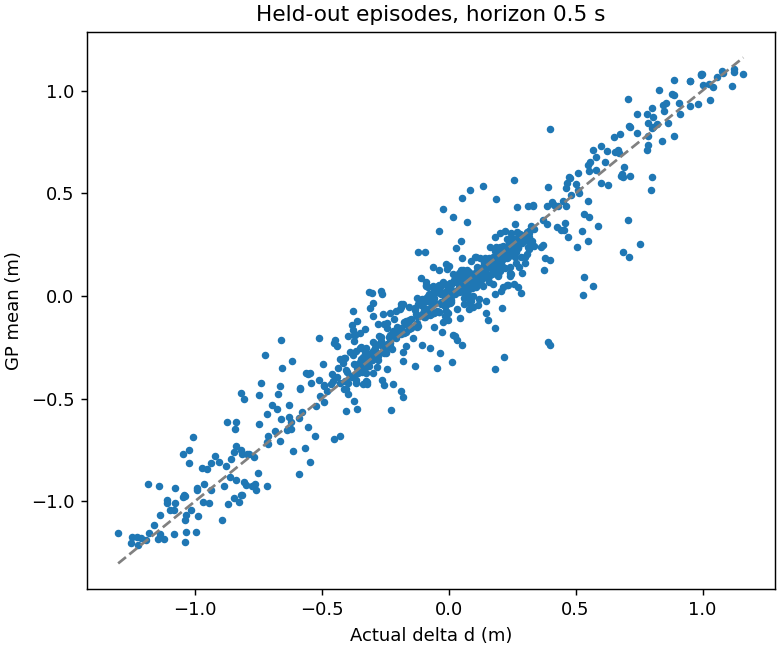

# 八輸入動作條件式 GP

日期：2026-11-18；分支 `master`；基於 `de3581a06604976980aa6efa36c1cf61b84fa84c`，含未提交修改。
使用者明確要求按目前參數訓練八輸入 GP，預測前車 0.5 s 後的橫向位移；12 場訓練、4 場驗證、4 場測試，每場 25 s，盡量少改舊程式。

## 已實作的方法

新增 [train_action_gp.py](../../../train_action_gp.py)，使用既有正式 `run_episode()` 與其 step_observer，沒有修改 main、策略或模擬步進。
在既有 [interaction.py](../../../training_data/interaction.py) 增加可選的動作輸入，並讓 [interaction_gp.py](../../../interaction_gp.py) 支援八輸入與全部樣本；舊七輸入模式及其預設 800 筆上限保留。

八項依序為：

| 名稱 | 定義 | 單位 |
| --- | --- | --- |
| gap | vehicle-2 s − vehicle-1 s，封閉賽道最短有號距離 | m |
| rear_d | vehicle-1 當下 d | m |
| front_d | vehicle-2 當下 d | m |
| relative_speed | vehicle-1 速度 − vehicle-2 速度 | m/s |
| front_speed | vehicle-2 車身速度 | m/s |
| front_lateral_speed | vehicle-2 d 在過去 0.1 s 的差分速度 | m/s |
| front_curvature | vehicle-2 所在中心線前後各 0.5 m 三點估計的有號曲率 | 1/m |
| d_target | vehicle-1 當下已採用的候選目標 d | m |

答案為 `d_front(t+0.5)-d_front(t)`，單位 m。50 Hz 同步記錄狀態，10 Hz 取訓練樣本；
排除第一筆無歷史、未來不足與整個 0.5 s 標籤窗內碰撞矩形重疊的樣本。
`d_target` 由控制前狀態所對應的決策取得，沒有把未執行的候選複製成相同答案；後續仍可重新決策，未強制固定該目標 0.5 s。

## 收集設定

沿用當下 main：圓角矩形中心線 20×12 m、彎道半徑 3 m、寬 2 m、500 點；步長 0.02 s。
vehicle-1 使用 relative_overtake，基準 s=0、目標 11 m/s；vehicle-2 使用 defend 指定 vehicle-1，基準 s=4、目標 9 m/s；GP 關閉。
模型速度上限 30 m/s、最大加減速度各 5 m/s²、前視距離 2 m、速度 gain=1.5。
碰撞矩形維持當下的 **0.6×1.2 m**，不是舊紀錄的 0.6×0.4 或 0.6×1.0 m；排除的是此矩形重疊，不等同實體車身碰撞。
進攻決策週期 0.05 s、預測 1.0 s，保留目前九個橫向候選及前車速度、前車−1、前車−4 m/s 的額外速度候選設定。

20 場各 25 s、seed=42；各場兩車都從 d=0、靜止起步，保留 4 m 車距與 11／9 m/s 目標速度。
各場僅將整組車輛沿賽道隨機平移，這是本次收集方式，不是使用者另行提出的研究動機。
實際場景與設定見 [data_metadata.json](data_metadata.json)；關鍵程式雜湊見 [source_hashes.json](source_hashes.json)。

## 訓練與切分方式

seed=42 依 episode 隨機切分 12／4／4，同場所有樣本留在同一組。
使用全部有效訓練樣本，不抽至 800 筆；StandardScaler 與 GP 只擬合訓練集。
沿用 ConstantKernel×ARD RBF + WhiteKernel，`normalize_y=True`、optimizer_restarts=0；
超參數只依訓練資料最佳化，驗證與測試只評估、不用來選參數，不合併驗證集重新擬合。
比較基準為固定橫向位移 0、訓練答案平均值、當下橫向速度延續 0.5 s。

## 實際訓練結果

完整資料共 4026 筆：12 場訓練 2309 筆，4 場驗證 910 筆、4 場測試 807 筆。
排除 20 筆無歷史、874 筆碰撞矩形重疊標籤窗、100 筆未來不足；每場有效樣本為 40～236 筆，因此下表為逐筆樣本加權，而非每場等權。
原始狀態 50040 列、後車決策 25000 列。全部訓練樣本均參與擬合，耗時 68.355 s，沒有依驗證／測試結果重新訓練。

| 模型 | 驗證 MAE（m） | 驗證 RMSE（m） | 測試 MAE（m） | 測試 RMSE（m） |
| --- | ---: | ---: | ---: | ---: |
| 八輸入 GP | 0.075690 | 0.111134 | 0.085968 | 0.130142 |
| 固定位移 0 | 0.313081 | 0.421173 | 0.351976 | 0.468345 |
| 訓練答案平均值 | 0.315465 | 0.420199 | 0.354231 | 0.466861 |
| 橫向等速延續 0.5 s | 0.503305 | 0.696640 | 0.551495 | 0.737386 |



量化結果以 [report.json](report.json) 與 [predictions.csv](predictions.csv) 為準；[train.log](train.log)／[程序狀態](train_status.json) 記錄本次實際擬合成功。
圖片目視上大部分點接近對角線，但仍有偏離；不能據此宣稱任意場景或所有候選都準確。

不利結果與資料限制：

- 最大測試絕對誤差 **0.640401 m**，發生在 action-014、t=5.3 s：實際 Δd=+0.399849 m，預測 −0.240552 m，d_target=−0.6 m。這裡連位移方向也預測錯誤，原因尚未驗證。
- 測試後車在右側（rear_d<−0.2 m）263 筆的 MAE 為 0.147626 m，高於後車在左側 457 筆的 0.054357 m；兩側表現不均。
- 驗證／測試的 ±2σ 涵蓋率分別為 94.18%／90.09%，尚未校準，不能當安全邊界。
- gap 的標準化 RBF length_scale 達下界 0.05，保留一則最佳化提示，未擅自改界限或重訓。
- 九種 d_target 均有出現，但 +0.6 m 有 2132 筆、+0.15 m 僅 27 筆，分布不均衡。
- 2182／4026 筆（54.20%）在後續 0.5 s 內改過目標；1425 筆的 gap<0，此時「前車」仍指指定的 vehicle-2，而非當下實際領先者。

本次環境為原有 Python 3.10.20、NumPy 2.2.6、scikit-learn 1.7.2，沒有安裝套件。

## 本次命令

以原有 `.venv` 執行，沒有安裝 Python 或套件；`MPLBACKEND=Agg`、`MPLCONFIGDIR=.cache/matplotlib`、
`TEMP/TMP=.cache/tmp`、`PYTHONUTF8=1`，`OPENBLAS_NUM_THREADS=OMP_NUM_THREADS=1`。

```powershell
.\.venv\Scripts\python.exe -m unittest -v tests.test_action_gp tests.test_interaction_gp
.\.venv\Scripts\python.exe train_action_gp.py --data data/training/action_gp_20261118_current8 --output models/gp/action_gp_20261118_current8 --pair vehicle-1 vehicle-2 --seconds 25 --seed 42 --collect-only
.\.venv\Scripts\python.exe interaction_gp.py train --data data/training/action_gp_20261118_current8 --output models/gp/action_gp_20261118_current8 --seed 42 --max-train 0
.\.venv\Scripts\python.exe reports/experiments/2026-11-18_action_gp/verify_model.py
```

目錄已存在時改用新路徑；舊模型及原資料不覆寫。

## 驗證紀錄

[相關測試](focused_tests.log)：8 項通過，含新增 3 項，涵蓋當下動作對齊、缺少動作報錯、舊七輸入相容、12／4／4、全部訓練樣本、train-only scaler 與模型重讀。
[完整測試](unittest.log)／[程序狀態](test_status.json)：352 項、2 個場景失敗，與先前 CHANGELOG 記錄的防守被動場景碰撞及相對策略未完成超車的測試名稱相同。
本次未修改策略或 main 參數來讓測試通過；相關 GP 測試均通過。
[保存模型核對](audit.json) 逐筆核對全部 4026 筆原始 0.5 s 標籤與 d_target，確認切分互斥、全部 2309 筆訓練樣本均使用、scaler 僅由訓練集擬合；重新載入模型後的驗證／測試誤差與報告一致。
核對腳本為 [verify_model.py](verify_model.py)，不重新擬合；模型 SHA-256 亦保存在 audit.json。

## 解讀與交接限制

固定一種地圖與防守配置，未驗證跨地圖、其他防守參數或其他動作分布的泛化。
模型只學當下已執行動作條件下、後續策略仍持續更新的觀測結果；不能直接聲稱已驗證任意未執行候選的反事實反應。
尚未接入規劃器，不能直接替換舊單一 s→d 模型；沒有進行七／八輸入的受控效果比較。
原始資料 `data/training/action_gp_20261118_current8/` 與模型 `models/gp/action_gp_20261118_current8/model.pkl`（約 42.8 MB）沿用 Git 忽略規則，僅在本機。
本目錄已保存小型設定、報告、驗證／測試預測、[動作事件](events.csv)、核對摘要與圖表，足以解讀結果，但不足以重訓相同模型。
本次不 commit 或 push。
