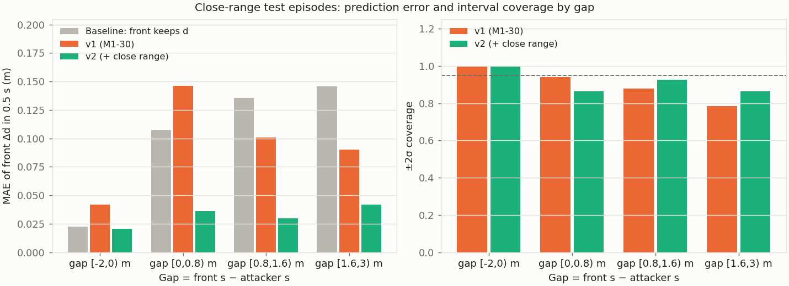
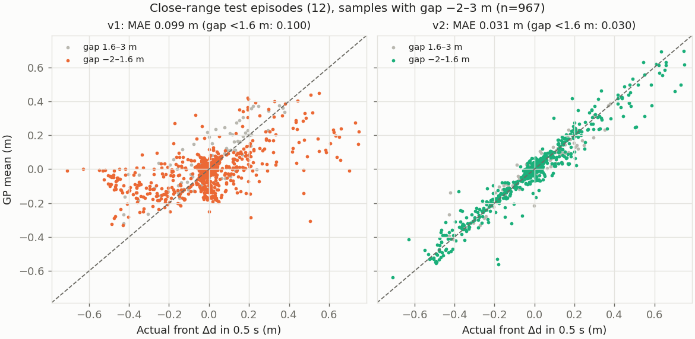
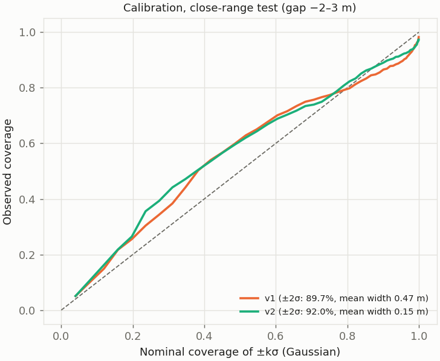
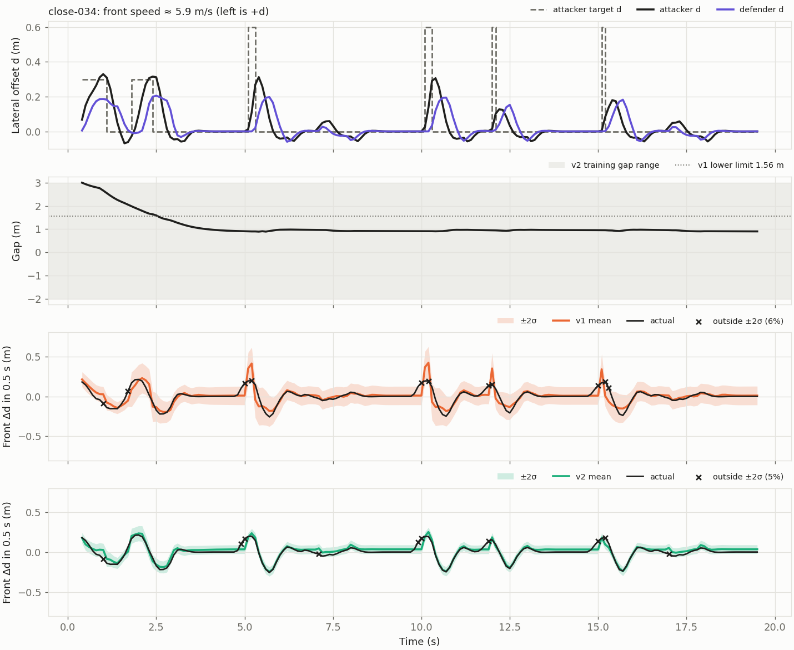
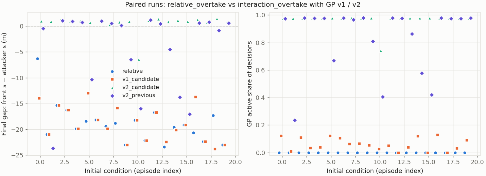

# 近距離互動資料與 GP v2

日期：2026-11-24；分支 `master`；基於 `7ace4ca`（tag `interaction-gp-v1`），含未提交修改。

使用者要求：
- 補收近距離互動資料，讓 GP 學會超車關鍵時刻的對手反應。
- 同時保存目前的 v1 模型（已完成，見 [models/registry.md](../../../models/registry.md)）。

使用者選定：用攻方實際超車收集、前車 3～7 m/s。

## 收集

- 命令如下（輸出見 [collect.log](collect.log)，實際設定見 [data_metadata.json](data_metadata.json)）：
  `collect --features history --rear-strategy relative_overtake --speed-strata 3 4 5 6 7 --deviation-weights 0 1 3 --speed-advantage 0.5 1.5 --initial-gap 1.5 4 --episodes 36 --seconds 20 --seed 44 --episode-prefix close`
- 攻方 relative_overtake（7 個訓練過的目標、橫移 3.0 m），對手 defend（main 的 DefenseConfig）；兩車移動中起步。
- 結果 6544 筆，依車距：

  | 車距 | 筆數 |
  | --- | ---: |
  | <−2 m（超車後） | 3120 |
  | −2～0 m | 405 |
  | 0～0.8 m | 542 |
  | 0.8～1.6 m | 2120 |
  | 1.6～3 m | 316 |

- 碰撞矩形重疊排除 368 筆，真正接觸的時段不在資料中。

## v2 訓練與離線比較（[train_compare.py](train_compare.py)）

- 切分：每個「速度區間 × 偏離權重」組合 2 場訓練、1 場測試（24／12 場）。
- 訓練集：新訓練場中車距 −2～3 m 的 2416 筆，加 v1 訓練樣本隨機抽 2584 筆，共 5000 筆。
- GP 設定與 v1 相同，擬合 232 s、無警告。
- 模型：本機 pkl 201 MB；精簡檔 `models/compact/interaction_gp_v2_close.npz` 455 KB，與 pkl 的預測差 0。

| 資料 | 車距 | n | 前車不動基準 MAE | v1 MAE | v2 MAE | v1 ±2σ 涵蓋 | v2 ±2σ 涵蓋 | v2 區間寬度 |
| --- | --- | ---: | ---: | ---: | ---: | ---: | ---: | ---: |
| 近距離測試 12 場 | −2～0 m | 137 | 0.023 | 0.042 | 0.021 | 100% | 100% | 0.185 |
| | 0～0.8 m | 153 | 0.108 | 0.146 | **0.036** | 94.1% | 86.3% | 0.145 |
| | 0.8～1.6 m | 589 | 0.136 | 0.101 | **0.030** | 87.8% | 92.5% | 0.138 |
| | 1.6～3 m | 88 | 0.146 | 0.090 | **0.042** | 78.4% | 86.4% | 0.180 |
| 舊保留 8 場 | 全部 | 1136 | 0.098 | 0.0229 | 0.0238 | 92.4% | 93.8% | 0.150 |
| speed06 測試 8 場 | 全部 | 2336 | 0.125 | 0.0269 | 0.0294 | 87.7% | 90.0% | 0.145 |

- 近距離誤差降到 v1 的 1/4～1/3；原距離範圍略差 4～9%（舊樣本只用了 2584／4040 筆）。
- 輸入落在訓練範圍內的比例（近距離測試場）：v1 1.8%、v2 42.6%。未落在範圍內的主要是車距 <−2 m 的樣本，訓練時已排除。
- 證據：[offline_summary.json](offline_summary.json)、[offline_per_episode.csv](offline_per_episode.csv)、[gap_bins.png](gap_bins.png)、[train_compare.log](train_compare.log)。

評估圖由 [plot_models.py](plot_models.py) 載入兩個精簡檔重新預測，不重新擬合。
只用近距離測試 12 場中車距 −2～3 m 的 967 筆。

- 實際對預測：v1 MAE 0.099 m、v2 0.031 m（車距 <1.6 m 時 0.100 對 0.030）。

  

- 校準曲線：
  - 兩者在小 k 時高於對角線、大 k 時略低，形狀相近。
  - ±2σ 實際涵蓋 v1 89.7%、v2 92.0%。
  - 區間平均寬度 v1 0.47 m、v2 0.15 m：v2 用窄得多的區間達到相近的涵蓋。

  

- 單場時間序列 [close-034](timeseries_close-034.png)：
  - 測試場中近距離樣本最多的一場；攻方未超車，車距停在約 0.9 m，多次短暫切出試探。
  - 區間外比例：v1 6%、v2 5%。v1 在攻方切出時常高估前車橫移（尖峰），v2 較貼近實際。

  

## 閉迴路成對評估（[evaluate.py](evaluate.py)）

- 與 [第一版評估](../2026-11-24_interaction_overtake/README.md) 相同的 20 組初始條件：前車 3～6 m/s、攻方＋1 m/s，每場 20 s。
- 使用目前 main 設定（deviation_weight=0.0）；四組都用 7 個訓練過的候選與相同成本。

| 指標 | relative（無 GP） | v1 各候選 | v2 各候選 | v2 上一次目標 |
| --- | ---: | ---: | ---: | ---: |
| 曾領先場數 | 20／20 | 20／20 | **1／20** | 8／20 |
| 首次領先中位數 | 6.16 s | 6.02 s | 14.88 s | 11.72 s |
| 碰撞重疊步數（場數） | 275（11） | 362（11） | 136（5） | **1162（20）** |
| 平均換目標次數 | 13.3 | 15.5 | **87.7** | **94.9** |
| GP 啟用比例 | – | 6.0% | 96.6% | 83.3% |
| 線上 GP MAE | – | 0.101 | 0.085 | 0.106 |
| 線上 ±2σ 涵蓋 | – | 66% | 81% | 71% |

- v2 各候選：攻方 73% 的時間停在車距 0.8～1.6 m，決策有 73% 選 ±0.6 m，在左右兩側來回切換。
- v2 各候選在車距 0.8～1.6 m 的線上 MAE 0.091 m，是離線（0.030）的 3 倍；0～0.8 m 也是 0.083 對 0.036。
- 證據：[closed_loop_summary.json](closed_loop_summary.json)、[closed_loop_per_episode.csv](closed_loop_per_episode.csv)、[paired_results.png](paired_results.png)、runs_*.json。

## 不利結果與限制

- **離線預測大幅改善，但閉迴路超車變差**：
  - v2 各候選只成功 1／20 場。
  - v2 上一次目標的碰撞步數是基準的 4 倍。
- 資料來自不使用近距離 GP 的攻方；用了 v2 之後攻方行為改變（來回切換），出現訓練資料沒有的狀態，線上誤差變大。
- 碰撞時段被排除在訓練資料外；單一地圖、單一防守設定、單一 seed、攻方速度優勢固定 1 m/s。
- 本實驗時 main 用 v1；評估完成後使用者自行把 main 切換為 v2（上表閉迴路結果是在 evaluate.py 內指定模型，不受 main 路徑影響）。

Codex 分析，未經使用者確認；待驗證：

- v2 學到「攻方往哪邊，防守車就擋哪邊」。
  - 各候選模式下，規劃器預期每一側都會被擋，在兩側之間反覆切換而不 commit，所以碰撞少但不超車。
  - 上一次目標模式的預測與實際動作錯位，允許了會衝突的路徑，所以碰撞多。
- 可能的下一步：
  - 用 interaction_overtake（v2）本身再收一輪資料重訓，類似 DAgger，涵蓋它自己造成的狀態。
  - 規劃器加入換目標成本或最短保持時間，抑制來回切換。
  - 只在 σ 小時採用 GP 預測。

## 驗證

- [完整測試](unittest.log)：440 項，2 項失敗。
  - 失敗的是防守被動場景 2 項，與先前同名。
  - 先前失敗的相對策略測試，在使用者把 deviation_weight 改為 0.0 後通過。
- probe_follow 預設收集回歸：seed 42、5 場、5 s 重收，場景參數與 t≤4.5 s 樣本與既有資料逐筆相同（smoke 資料已刪除）。
- 精簡檔核對：v2 500 筆預測差 0；v1 在兩個閉迴路場景的決策與 pkl 逐步相同（見 registry）。
- 本次分析中途，兩支腳本曾寫入同名的 summary.json／per_episode.csv 而互相覆蓋。已改成 `offline_*`／`closed_loop_*` 分開。
  離線結果用已保存的模型重算，與第一次輸出（train_compare.log）完全相同。
- [source_hashes.json](source_hashes.json) 記錄程式、資料與模型雜湊；原始資料與 pkl 只在本機。
