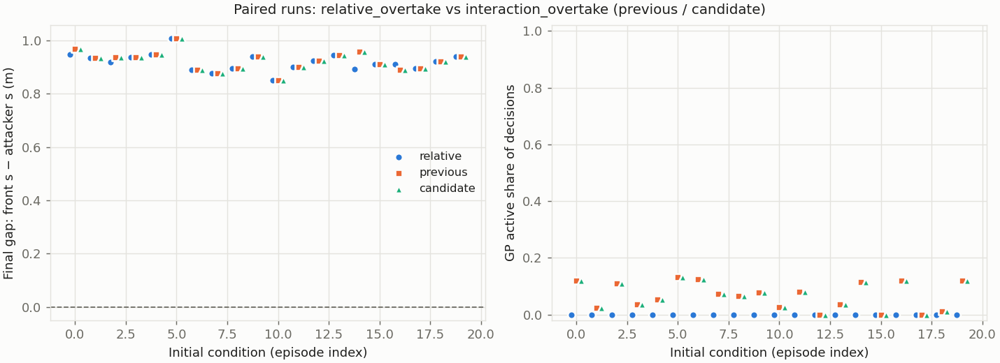

# 互動 GP 超車（interaction_overtake）第一版評估

日期：2026-11-24；分支 `master`；基於 `4cf0c42`，含未提交修改。

使用者要求把互動歷史 GP 初步整合進超車決策，原始想法是用上一次決策的候選預測前車位置，再據此避碰選路。
使用者指出「當下觀測＋上一次決策目標」的時間錯位疑慮後，決定兩種查詢方式都實作並比較；
並選定：超出 GP 訓練範圍時退回定速等 d、避碰用平均＋±2σ 帶。

## 方法

- 策略 [interaction_overtaking.py](../../../strategy/interaction_overtaking.py) 繼承 `relative_overtake`：
  - 候選、成本與避撞責任約束不變，只把前車預測換成 GP。
  - 前車軌跡：縱向定速；d 在 0.5 s 內由 d0 線性到 d0+μ，之後維持。
  - 另檢查前車在 μ±2σ 兩條邊界軌跡時，自車 rollout 是否違反同一約束。
- 特徵：[interaction_features.py](../../../strategy/interaction_features.py)，訓練資料也改呼叫同一套函式。重建兩份資料集的特徵，與原 samples.csv 逐位元相同。
- GP 啟用條件：歷史 ≥0.4 s、13 個輸入都在模型訓練資料的最小～最大值內、後車−前車速度在範圍內、d_target 是訓練過的值。
- 兩種查詢方式：
  - `candidate`：每個橫向候選以自己的目標查 GP，與訓練時「當下採用的目標」定義一致。
  - `previous`：以上一次決策的目標查一次，所有候選共用。
- 模型 M1-30（`models/gp/speed06_20261124_c_m1_30/model.pkl`，只在本機）。

## 評估設定

- 命令：`evaluate.py run --strategy relative|previous|candidate`（三組並行），再 `evaluate.py summarize`。腳本見 [evaluate.py](evaluate.py)。
- 圓角矩形；攻方 rear、防守 front（`defend`，main 的 DefenseConfig）。
- 20 組初始條件（seed=7）：前車 U(3,6) m/s、攻方＝前車＋1 m/s、初距 U(2,5) m，兩車移動中起步；每場 20 s。
- 三組用相同候選（0、±0.3、±0.45、±0.6 m）、transition_length 3.0 m、成本與避撞責任設定；`relative` 只是沒有 GP。
- 「領先」指攻方 s 超過前車 0.6 m（碰撞框長）。

## 量化結果

| 指標 | relative | previous | candidate |
| --- | ---: | ---: | ---: |
| 曾領先的場數 | 0／20 | 0／20 | 0／20 |
| 碰撞矩形重疊（步數；場數） | 5；1 | 5；1 | 5；1 |
| 平均目標切換次數 | 12.35 | 12.35 | 12.35 |
| GP 啟用決策 | – | 443／6680（6.6%） | 443／6680（6.6%） |
| 線上 GP MAE（m） | – | 0.034 | 0.031 |
| 線上 ±2σ 涵蓋率 | – | 95.0% | 97.3% |
| 換目標決策的 GP MAE（31 次） | – | 0.101 | 0.054 |

- GP 未啟用的原因：車距超出範圍 6097 次（91.3%）、歷史不足 140 次（每場開頭 0.4 s）。
- 車距在開始後 0.42～3.06 s 就低於 GP 訓練下限（約 1.56 m），之後攻方都貼在前車後方 0.71～1.0 m，期末落後 0.85～1.01 m。
- 15／20 場三組的決策完全相同。另 5 場（io-000、002、013、014、016）在車距約 1.6～2 m 時：
  - 原策略選 +0.3 m，兩種 GP 版本選 0 m。
  - 期末車距差異 ≤0.066 m。
- 線上 GP 誤差：用實際執行目標的預測，比對模擬中前車 0.5 s 後的位移。逐場見 [per_episode.csv](per_episode.csv)，彙總見 [summary.json](summary.json)。

## 不利結果與限制

- 新策略在這個設定下**沒有改變超車結果**：三組都 0 次超車，基準策略本身也無法超越防守車。
- GP 只在 6.6% 的決策啟用：訓練資料來自試探跟車（車距約 2.5 m），攻方實際運作在 0.7～1.6 m。
- 換目標決策只有 31 次，對齊（candidate）誤差較低的結果樣本很少。
- 單一地圖、單一防守設定、單一 seed、攻方速度優勢固定 1 m/s。

Codex 分析，未經使用者確認；待驗證：

- relative_overtake 的成本（終點相對間距、近距安全項）在車距 ≥1.6 m 時幾乎不受前車橫向位置影響。
  即使 GP 啟用，也只能透過約束影響決策，這可能是 GP 影響很小的第二個原因。
- 可能的下一步：
  - 收集攻方近距離（0.5～2 m、並排）的互動資料重訓 GP。
  - 在成本中加入與「預測前車橫向位置」有關的項。
  - 改成先在 GP 適用距離試探、再決定換邊的策略。
  - 另選基準策略能完成超車的場景再比較。

## 驗證

- [相關測試](focused_tests.log) 28 項通過：特徵一致、歷史查詢、查詢條件、退回規則、前車軌跡、±2σ 邊界剔除、模型載入、工廠註冊。
- [完整測試](unittest.log)：439 項，3 項失敗，與先前紀錄同名。
- 既有行為不變：用 [verify_equivalence.py](../2026-11-24_refactor_equivalence/verify_equivalence.py) 比對 11 個場景。
  修改前取自 HEAD 暫時工作樹的 [equivalence_head.json](equivalence_head.json)，修改後是 [equivalence_after.json](equivalence_after.json)，11 個全部逐位元相同。
  - 舊的 equivalence_after_fix.json 錄於 `901ae7f` 加當時未提交的參數，之後 main 參數已改過，不能直接比。
- `python main.py --interaction-overtake`（Agg、8 s）可執行；實際 TkAgg 視窗未目視確認。
- 原始逐步結果 [runs_*.json](runs_candidate.json) 已保存（每份約 1.9 MB），可重新彙整。
