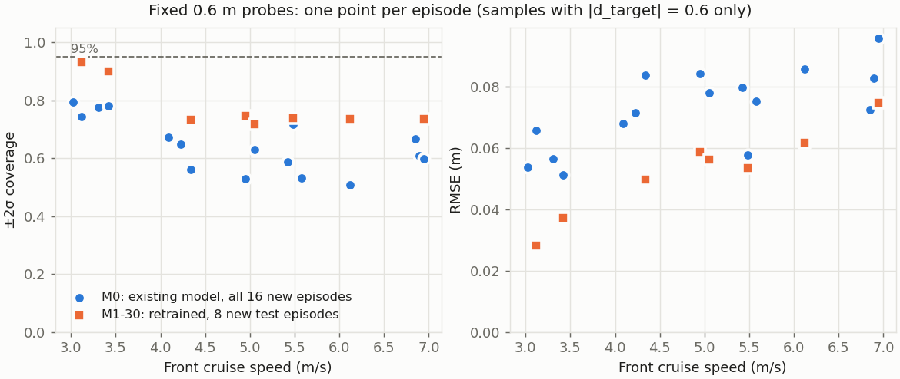

# 前車速度 × ±0.6 m 試探：新場次與 30 s 比較

日期：2026-11-24；分支 `master`；基於 `e433211`，含未提交修改。

背景見 [涵蓋率診斷](../2026-11-24_coverage_diagnosis/README.md)：涵蓋不足集中在 ±0.6 m 試探，且速度與幅度的影響混在一起。
使用者轉述 ChatGPT 的建議（若只做一個實驗，就補收「不同速度 × 左右 ±0.60 m」的新場次，部分延到 30 s），並核准本實驗計畫；
這次**不做 σ 校準**（使用者選擇）。

要回答三件事：

1. 幅度固定 0.6 m 時，誤差是否隨前車速度變大。
2. 加入這類場次後，0.6 m 試探的誤差是否下降。
3. 同一批場次用完整 30 s，是否比只用前 15 s 好。

## 設定

- 命令（輸出見 [collect.log](collect.log)、[compare.log](compare.log)；實際設定見 [data_metadata.json](data_metadata.json)）：

  ```powershell
  .\.venv\Scripts\python.exe interaction_gp.py collect --features history --randomize-probes --probe-amplitudes 0.6 --speed-strata 3 4 5 6 7 --episodes 16 --seconds 30 --seed 43 --episode-prefix speed06 --output data/training/history_speed06_20261124
  .\.venv\Scripts\python.exe reports/experiments/2026-11-24_speed_amplitude_probe/compare.py
  ```

- 16 場、每場 30 s、4672 筆（10 Hz），沒有碰撞排除。前車巡航速度分 [3,4)、[4,5)、[5,6)、[6,7) m/s 各 4 場，後車 +2 m/s。
- 每個速度區間平衡「先左／先右」×「靜止／移動中起步」；試探全為 ±0.6 m、左右交替，hold 1.14～2.45 s；初距 2.1～4.9 m。
- 防守與試探跟車其他參數與上一輪相同（圓角矩形、defend 決策週期 0.05 s、probe_follow target_gap 2.5 m）。
- 模型 c（13 維），GP 設定不變（ARD RBF＋WhiteKernel，無 restart）：
  - M0：上一輪的模型，不重訓。
  - M1-15：舊 12 場訓練＋新訓練 8 場的前 15 s，共 2840 筆，擬合 67 s。
  - M1-30：舊 12 場訓練＋新訓練 8 場完整 30 s，共 4040 筆，擬合 140 s。
  - 兩者都沒有擬合警告。
- 新場次切分：每區間（先左、靜止）＋（先右、移動）訓練，（先右、靜止）＋（先左、移動）測試。
- 「0.6 m 樣本」指後車當下目標 |d_target| = 0.6，包含移向該側與保持期間。

## 結果

### 1. 固定 0.6 m 時的速度效應（M0，新 16 場都沒看過）

每場只計 0.6 m 樣本，0～30 s 合併：

| 前車速度 | 4 場涵蓋率 | 中位數 | 4 場 RMSE（m） | 中位數 |
| --- | --- | ---: | --- | ---: |
| [3,4) | 0.74、0.78、0.78、0.79 | 0.78 | 0.051～0.066 | 0.055 |
| [4,5) | 0.53、0.56、0.65、0.67 | 0.61 | 0.068～0.084 | 0.078 |
| [5,6) | 0.53、0.59、0.63、0.72 | 0.61 | 0.058～0.080 | 0.077 |
| [6,7) | 0.51、0.60、0.61、0.67 | 0.61 | 0.072～0.096 | 0.085 |

- 幅度相同時，3～4 m/s 的 4 場都比 4 m/s 以上的 12 場好；4 m/s 以上三個區間互相重疊，沒有一路變差的趨勢。
- 最慢的區間涵蓋率也只有 74～79%：0.6 m 試探本身就會涵蓋不足，速度再加重。



### 2、3. 加入新場次與 30 s 的效果（新測試 8 場）

| 模型 | 0.6 m，0～15 s：MAE／涵蓋率 | 0.6 m，15～30 s：MAE／涵蓋率 | 回中，0～30 s：MAE |
| --- | --- | --- | --- |
| M0 | 0.054 m／66.5% | 0.062 m／60.5% | 0.014～0.017 m |
| M1-15 | 0.053 m／71.1% | 0.061 m／64.8% | 0.016～0.018 m |
| M1-30 | **0.039 m／79.6%** | **0.041 m／77.0%** | 0.013～0.014 m |

- M1-30 在 8 場測試的 0.6 m 樣本上，**每一場 MAE 都下降**（0.040～0.073 → 0.022～0.059 m），涵蓋率每一場都上升（0.51～0.78 → 0.72～0.93）。
- M1-15（同 8 場訓練，只用前 15 s）的 0.6 m MAE 幾乎沒變，8 場中 4 場反而變差；涵蓋率上升主要來自區間變寬（0.128 → 0.150 m）。
- 重訓後速度效應仍在：M1-30 下兩場慢速（3.1、3.4 m/s）涵蓋率 0.90～0.93，其餘 6 場 0.72～0.74。

完整合併數字見 [summary.json](summary.json)，逐場見 [per_episode.csv](per_episode.csv)，輸出見 [compare.log](compare.log)。

## 不利結果

- 涵蓋率仍未達 95%：M1-30 在新測試 0.6 m 樣本為 77～80%。
- 舊保留 8 場（原驗證＋測試）變差的部分：
  - 整體 MAE 0.0219 → 0.0229 m。
  - 0.3／0.45 m 試探 MAE 0.0165 → 0.0225 m。
  - ±2σ 平均寬度 0.099 → 0.138 m，8 場都變寬。
  - 015 場 MAE 0.026 → 0.040 m、涵蓋率 0.87 → 0.80。
- 加入 0.6 m 資料後，固定雜訊的標準差 0.0188 → 0.0232 m；雜訊不分情境，簡單樣本的區間也跟著變寬。
- M1-15 與 M1-30 的差異同時包含「場內時間更長」與「樣本數 1136 → 2336」，也可能受超參數最佳化（無 restart）的局部解影響；只有一個 seed 與一種切分。
- 每個速度區間只有 4 場（M0）或 2 場（M1 測試）；單一地圖、單一防守配置，前車速度範圍 3～7 m/s。

Codex 分析，未經使用者確認；待驗證：舊資料的 0.3／0.45 m 預測變差，可能是新資料全為 0.6 m，改變了 d_target 等輸入的學習尺度。

## 驗證

- `-m unittest tests.test_interaction_gp`：14 項通過，含新增 3 項（固定幅度與先行側、平衡設計、預設抽樣不變）。
- [完整測試](unittest.log)：425 項，3 項失敗，與先前紀錄同名（防守被動場景 2 項、相對策略 1 項）。
- 回歸檢查：舊參數 `--episodes 5 --seconds 5 --seed 42` 重收的場景參數與 `history_gp_20261124` 前 5 場相同，t≤4.5 s 的 210 筆樣本逐筆相同；smoke 資料已刪除。
- M0 在舊保留 8 場的 MAE 0.0219、涵蓋率 90.0%，等於原報告驗證與測試的平均。
- [source_hashes.json](source_hashes.json) 記錄程式、資料與模型雜湊；原始資料與 M1 模型（models/gp/speed06_20261124_c_m1_*）沿用 .gitignore，只在本機。
