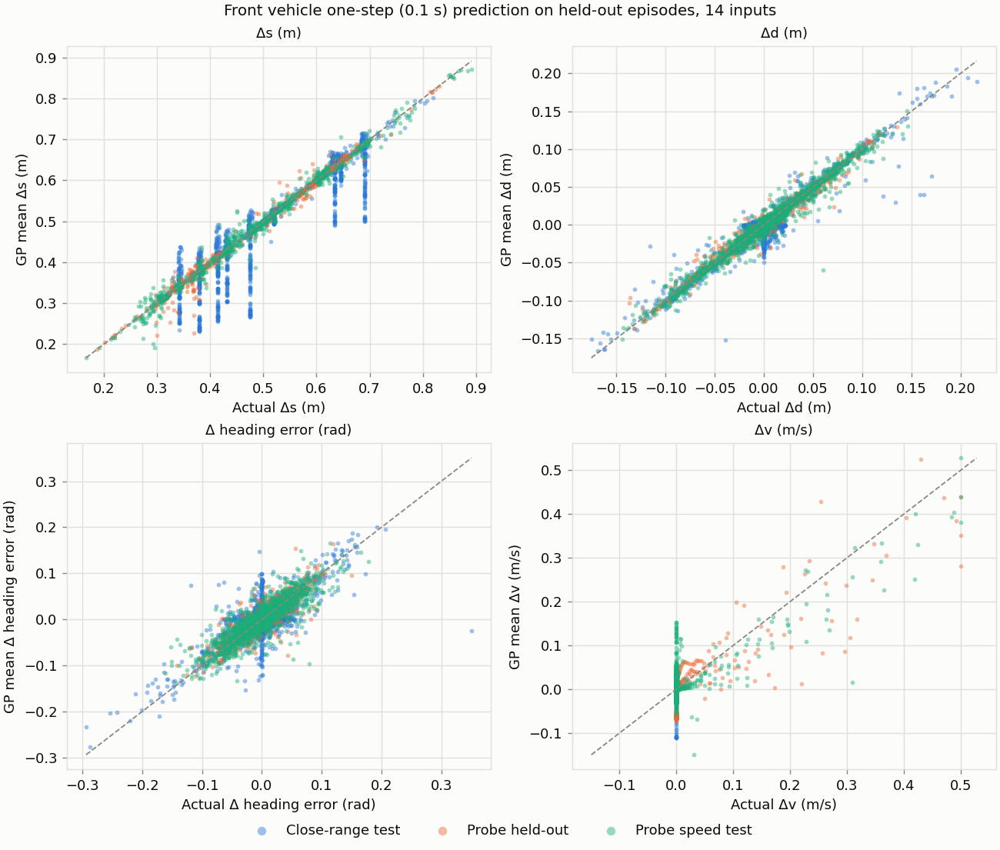

# 論文格式 GP 第一版：一步 0.1 s、14 維輸入（單一防守策略）

日期：2026-11-25；分支 `master`；基於 `015134b`，含未提交修改。

## 目的與範圍

參考 Lee et al.（RA-L 2024，KM-DKL）的 GP 輸入與輸出，先訓練一版只針對目前這一種 `defend` 設定的模型。

- 輸入：論文 z_k 的 10 維，加上 v2 的 4 個歷史 d 變化，取代論文的 M=10 序列＋CNN encoder。
- 答案：前車 0.1 s 後的 [Δs, Δd, Δe_ψ, Δv]，4 個獨立 GP。
- 不含 `d_target`。
- 沒有 DKL 與 kernel metric learning，只有一種防守策略，也沒有多步推演或接入規劃器。

欄位定義見 [GP_TRAINING.md](../../../GP_TRAINING.md#論文格式一步-gp第一版尚未接入策略)；計算在 `strategy/interaction_features.py`，資料建構在 `training_data/interaction.py` 的 `build_paper_dataset`。

## 設定

- 資料：不重新模擬，由三份既有原始紀錄重建。三份的前車設定相同（q_block=15、progress 2、smooth 1、deviation 3、責任約束開啟），腳本會核對設定與賽道。

  | 來源 | 後車 | 場數 | 樣本 | raw_states.csv SHA-256 |
  | --- | --- | ---: | ---: | --- |
  | `history_gp_20261124` | probe_follow | 20 | 2920 | `6022587acd94…` |
  | `history_speed06_20261124` | probe_follow | 16 | 4736 | `5a8ba8db7023…` |
  | `close_range_20261124` | relative_overtake | 36 | 6816（碰撞略過 240） | `23a5552b6b14…` |

- 切分：完全沿用 v2。
  - history_gp：`split_groups(seed=42)`，腳本核對與 v1／v2 紀錄相同。
  - speed06：沿用 speed06 實驗紀錄的切分。
  - close_range：每個設計格的最後一場測試，共 24 場訓練、12 場測試。
- 訓練樣本選取同 v2：close_range 訓練場 gap −2～3 m 的 2540 筆，加上試探資料訓練場 2460 筆，共 5000 筆。4 個 GP 用同一批樣本。
- 模型：同 v2，StandardScaler＋Constant×ARD RBF＋White、normalize_y、無 restart。
- 擬合時間：Δs 331 s、Δd 346 s、Δe_ψ 473 s、Δv 212 s。
- 比較基準：
  - 全 0。
  - 等速外推：Δs=v·0.1、Δd=front_dd_late×0.1/0.2、Δe_ψ=0、Δv=0。
- 模型：`models/gp/paper_format_20261125/model.pkl`（803 MB，SHA-256 `60615c533ea7…`，只在本機）。

## 量化結果（離線，一步 0.1 s）

近距離測試 12 場、論文評估範圍 0 ≤ gap ≤ 2 m（803 筆）：

| 答案 | 全 0 MAE | 等速 MAE | GP MAE | ±2σ 涵蓋 |
| --- | ---: | ---: | ---: | ---: |
| Δs (m) | 0.4975 | 0.0103 | **0.0021** | 93.4% |
| Δd (m) | 0.0355 | 0.0250 | **0.0050** | 92.0% |
| Δe_ψ (rad) | 0.0365 | 0.0365 | **0.0131** | 92.5% |
| Δv (m/s) | **0.0000** | **0.0000** | 0.0070 | 98.3% |

試探資料的保留場（全部車距）：

| 測試集 | 筆數 | Δd：等速／GP MAE、涵蓋 | Δs：等速／GP MAE | Δv：不變／GP MAE |
| --- | ---: | --- | --- | --- |
| history_gp 保留 8 場 | 1168 | 0.0153／**0.0031**、94.4% | 0.0102／**0.0037** | **0.0111**／0.0181 |
| speed06 測試 8 場 | 2368 | 0.0175／**0.0036**、89.0% | 0.0148／**0.0035** | **0.0056**／0.0193 |

其他分組（直線／彎道、各車距區間）與各場結果見 [summary.json](summary.json)、[per_episode.csv](per_episode.csv)、[評估輸出](eval_rerun.log)。



預測耗時：4 個 GP 一次預測 1 列約 19 ms、25 列約 80 ms（含 std，5 次中位數）。

## 不利結果與限制

- **Δv 比「車速不變」差**：所有測試集都是如此。
  - 近距離資料的前車一直以巡航速度行駛，Δv 全為 0。
  - 試探資料中，只有靜止起步的加速段 Δv 不為 0。
  - 擬合結果：雜訊落在下限 1e-6、前車車速尺度落在下限 0.05，其餘 11 欄落在上限 20。
- **攻方超過後（gap < −2 m）在訓練範圍外**：近距離測試有 1284 筆屬於這種情況。
  - Δs MAE 0.0412（等速 0.0010），±2σ 涵蓋只有 40.8%，即圖中 Δs 的垂直條紋。
  - Δd、Δe_ψ 也比基準差：Δd 0.0077 對 0.0056、Δe_ψ 0.0197 對 0.0114。但這兩個答案的 σ 有放大，涵蓋率分別為 98.6%、96.0%。
  - 因此近距離測試「全部」的 Δs MAE 是 0.0239，比等速 0.0048 差。
- 擬合警告：
  - Δs：雜訊碰到下限，4 欄尺度碰到上限。
  - Δe_ψ：後車車速尺度碰到上限。
  - Δv：13 項。
  - 都沒有重新調整界限。
- 只有一種防守策略、沒有 encoder；ζ=1.0 m 尚未調參。
- 一步 0.1 s 的指標不能直接和 v2 的 0.5 s Δd 比較，也不能代表多步推演或閉迴路的表現。多步推演尚未量測。
- 試探資料保留場的 ±2σ 涵蓋率為 88～94%，尚未校準。

待驗證的分析：

- Δv 變差可能是因為輸入中沒有前車的目標速度，GP 只能用當下車速去內插加速段。若之後推演使用 Δv，可以考慮直接設為 0，或在資料中加入變速的防守。
- gap < −2 m 的樣本若要納入，需要攻方超越之後的訓練資料，或在使用時加上範圍檢查。

## 驗證

- 新增 4 項測試（`tests/test_interaction_features.py` 的 `PaperFeatureTests`），涵蓋：
  - 欄位順序與數值，歷史 4 欄與 v2 逐位相同。
  - 曲率前看點。
  - 跨圈 Δs、跨 ±π 的 Δe_ψ。
  - 一步標籤與略過規則。
- 全套測試 453 項，2 項失敗（[unittest.log](unittest.log)）。
  - 失敗的是 `test_no_defense_for_ahead_alongside_far_or_unspecified_vehicle` 的兩個子案例，與 [rollout_overtake 時的基線](../2026-11-25_rollout_overtake/unittest.log)同名，本次沒有新增失敗。
  - 既有的互動特徵、互動 GP 與訓練資料測試全部通過；共用的窗內檢查抽出後，basic／history 的結果不變。

## 重現

```powershell
.\.venv\Scripts\python.exe reports/experiments/2026-11-25_paper_format_gp/train_eval.py
```

- 需要本機的三份原始資料。
- 模型已存在時會核對訓練選取並沿用，只重做評估；要重新擬合，先把 `models/gp/paper_format_20261125/` 改名。
- 逐筆預測 `predictions.csv`（3.4 MB）存在模型目錄，只在本機。
- 擬合過程見 [train_eval.log](train_eval.log)。這份 log 的評估表是加入車距範圍外分組之前的版本，數字與重跑相同，只少了分組。
