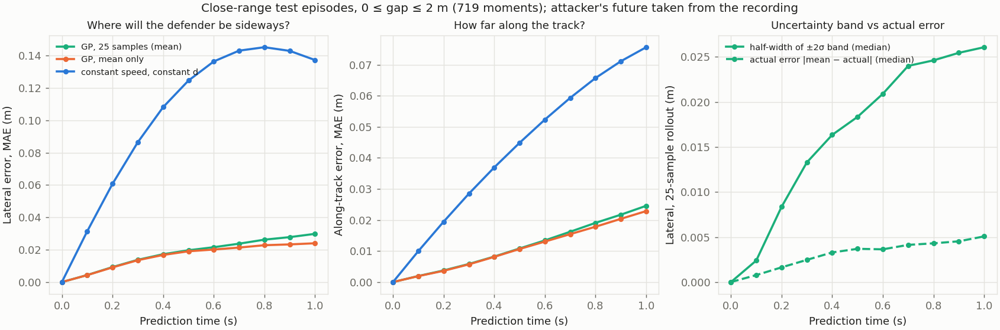

# 論文格式 GP 的離線多步推演評估（自車未來用實際紀錄）

日期：2026-11-25；分支 `master`；基於 `534c18a`，含未提交修改。

## 目的

[paper_rollout_overtake 單場示範](../2026-11-25_paper_rollout_overtake/README.md)在閉迴路中出現兩個現象：
- +1 s 的 σ_d 中位數 0.146 m。
- 前車 d 的 ±2σ 涵蓋只有 57～64%。

閉迴路裡的推演依的是「上一步計畫」，所以分不出問題是在模型本身，還是計畫與實際不符。這裡把計畫換成錄下來的自車實際軌跡，只看模型與推演本身。

## 設定

- 推演直接呼叫 `PaperRolloutOvertakingStrategy._rollout`，與線上同一份程式。自車未來包成 `PreviousPlan` 交給它。
- 模型：`models/compact/paper_gp_v1.npz`。Q=25、seed=0；時域 1.0 s，一步 0.1 s。
- 比較三種：
  - **sampled**：25 個樣本抽樣，取樣本平均（線上的作法）。
  - **mean**：只回饋 GP 平均，σ 設為 0。
  - **constant**：定速、d 不變，即線上的退回。
- 時刻的條件：前 0.4 s 歷史與後 1.0 s 都在、窗內沒有碰撞。
- 兩個測試集：
  - **close**：`close_range_20261124` 的測試 12 場（同 v2 切分），起點車距 0～2 m，每 0.1 s 一個時刻，共 735 個。
    - 第 0 步超出範圍 16 個（前車速度 15、航向誤差 1），比較用其餘 719 個。
  - **old**：`history_gp_20261124` 的保留 8 場（攻方左右試探、車距較遠），每 0.5 s 一個時刻，共 224 個。
- 命令：`python reports/experiments/2026-11-25_paper_multistep_offline/evaluate.py`，耗時 818 s。
- 輸出：[summary.json](summary.json)、[moments.csv](moments.csv)（逐時刻結果）、[evaluate.log](evaluate.log)、圖。

## 結果（離線）

近距離 close，719 個時刻：

| 指標 | sampled | mean | constant |
| --- | ---: | ---: | ---: |
| d 的 MAE：+0.5／+1.0 s | 0.020／0.030 m | 0.019／0.024 m | 0.125／0.137 m |
| d 的 90 百分位：+1.0 s | 0.085 m | 0.064 m | 0.386 m |
| s 的 MAE：+0.5／+1.0 s | 0.011／0.025 m | 0.011／0.023 m | 0.045／0.076 m |
| ±2σ 涵蓋 d：+0.5／+1.0 s | 93.6／98.6% | – | – |
| ±2σ 涵蓋 s：+0.5／+1.0 s | 96.9／96.1% | – | – |
| σ_d、σ_s 中位數：+1.0 s | 0.013、0.035 m | – | – |

- 中途改為等速的樣本占 4.4%，原因大多是前車航向誤差（613 次）。
- σ_d 中位數由 0.1 s 的 0.0012 m 增加到 1.0 s 的 0.013 m，約 11 倍。若各步誤差獨立，應約為 √10≈3.2 倍。

試探 old，224 個時刻：
- +1.0 s：d 的 MAE sampled 0.019、mean 0.015、constant 0.175 m；s 的 MAE 為 0.070、0.073、0.138 m。
- ±2σ 涵蓋：d 96.0%，s 只有 69.6%。

與閉迴路單場示範（k=2）對照：

| | 離線 close（實際自車未來） | 閉迴路示範（上一步計畫） |
| --- | ---: | ---: |
| +1 s 的 d MAE | 0.030 m | 0.250 m |
| +1 s 的 σ_d 中位數 | 0.013 m | 0.146 m |
| +1 s 的 d ±2σ 涵蓋 | 98.6% | 56.5% |
| 中途超出範圍的樣本 | 4.4% | 19.8% |

## 不利結果與限制

- 25 個樣本的平均沒有比只回饋平均準（+1 s 的 d MAE 0.030 對 0.024 m）。抽樣的用途只剩提供 σ，耗時卻約為只回饋平均的 4 倍。
- 試探資料的縱向 ±2σ 涵蓋只有 70～77%：縱向不確定性偏小。這份資料有靜止起步的加速段。
- 近距離的 d 涵蓋 98.6%、±2σ 半寬中位數約為誤差中位數的 5 倍，區間偏保守；但 d 誤差有長尾（90 百分位 0.085 m）。
- 時刻來自 relative_overtake 收集的資料，攻方動作較平順；與 paper_rollout_overtake 閉迴路裡的攻方動作不同。
- 單一種子；兩個集合的時刻都有時間相關，不是獨立樣本。

待驗證的分析：
- 自車未來已知時，模型與推演本身表現良好。閉迴路中 σ_d 放大約 11 倍、涵蓋率下降，比較可能來自閉迴路的使用方式，而不是模型：
  - 上一步計畫與實際不符：閉迴路中攻方換目標 184 次。
  - 攻方頻繁換邊、降速，超出訓練資料的分布：閉迴路超出範圍的原因以「後車−前車速度」最多，離線只有 27 次。
- 兩者各自的影響尚未分開量測。
