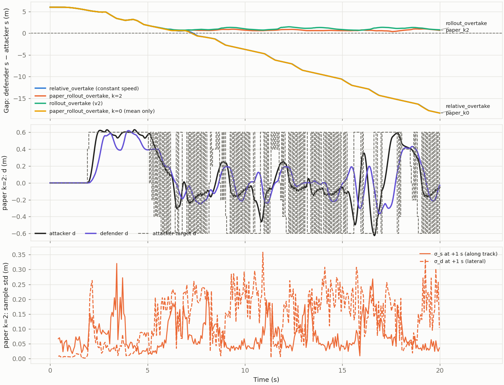
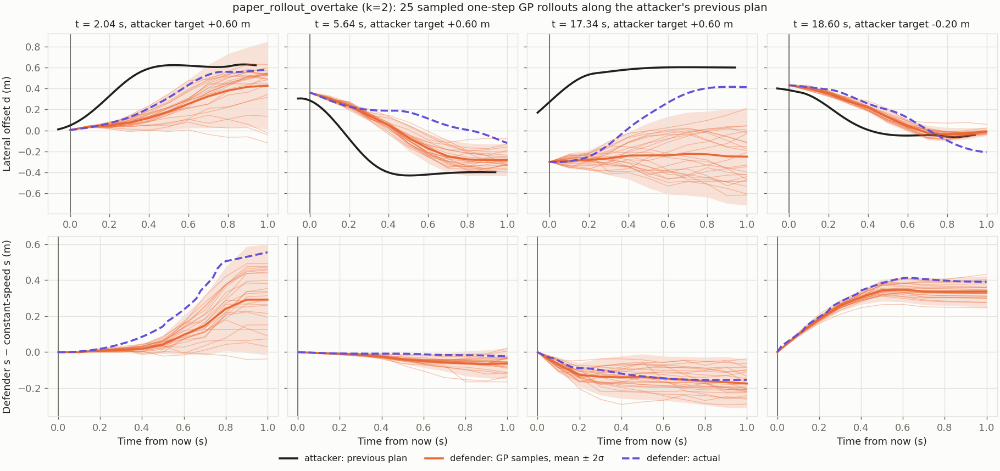

# paper_rollout_overtake：論文方式的一步 GP 取樣推演＋不確定性橢圓（單場示範）

日期：2026-11-25；分支 `master`；基於 `534c18a`，含未提交修改。

## 策略

[strategy/paper_rollout_overtaking.py](../../../strategy/paper_rollout_overtaking.py)，繼承 relative_overtake。參照 Lee et al.（RA-L 2024）使用一步 GP 的方式，規劃器沿用候選＋Pure Pursuit。

| 論文 | 這裡的作法 |
| --- | --- |
| 一步 GP 遞迴推演 N 步 | 一步 0.1 s，N＝預測時域 1.0 s／0.1＝10 |
| 推演時 EV 的未來取上一步計畫 | 第 0 步用實際觀測；之後取上一次決策選中候選的軌跡（同 rollout_overtake） |
| Q=25 個樣本，每步從 N(μ, σ²) 抽樣回饋 | 同左。4 個輸出各自抽樣，種子固定 |
| 樣本統計得到平均與 σ | 每個節點的樣本平均縱向進度與 d，以及 σ_s、σ_d |
| MPCC：最大化進度＋依 σ 放大的橢圓避撞 | 候選與成本同 relative_overtake。所有候選共用同一份前車預測，終點間距成本等同比較自車進度。避撞責任的圓 r_col 改成橢圓：沿賽道半軸 r_col＋kσ_s、橫向半軸 r_col＋kσ_d |

每次決策只推演目標前車：

1. **上一步計畫**：上一次決策選中候選的預測軌跡，取 t − t_prev 起的部分。
2. **取樣推演**：25 個樣本從前車目前的 (s, d, e_ψ, v) 出發，每 0.1 s：
   - 用 14 維特徵查 4 個 GP（[論文格式 GP 第一版](../2026-11-25_paper_format_gp/README.md)），從 N(μ, σ²) 抽 [Δs, Δd, Δe_ψ, Δv] 更新各自狀態。
   - 自車：第 0 步用實際觀測，之後取上一步計畫在對應時刻的狀態。
   - 歷史欄位（τ−0.2、τ−0.4 s 的 d）：不晚於現在用實際紀錄；晚於現在時，自車用計畫值，前車用該樣本自己的推演值。
   - 特徵由 `paper_feature_rows` 一次算 25 列，與訓練用的 `paper_state_features` 逐欄相同（有測試核對）。
3. **預測分佈**：
   - 樣本平均（縱向進度、d）內插到 0.02 s 格點，當作前車預測，用於終點間距、安全距離成本與避撞檢查。
   - 避撞責任的橢圓以平均位置的賽道切線為軸，半軸增量 kσ 線性內插到檢查時間。
   - 誰負責（overlap_rule）與 leader 懲罰都不變；σ=0 時與原本的圓相同。
4. **退回**：
   - 第一次決策、歷史不足、第 0 步超出 GP 訓練範圍時，整段退回定速等 d，決策與 relative_overtake 相同。
   - 之後某個樣本超出範圍時，只有該樣本改為等速等 d 前進。

設定在 `main.py` ⑤-4 `PAPER_ROLLOUT_OVERTAKING_CONFIG`：
- relative＝`RELATIVE_OVERTAKING_CONFIG`：
  - 橫向候選 −0.6～0.6 m，每 0.2 m 一個。
  - 每條都搭配巡航，以及前車同速、前車−1、前車−4 m/s 三種速度上限。
- Q=25、k=2、seed=0。

## 模型

| 項目 | 內容 |
| --- | --- |
| 精簡檔 | `models/compact/paper_gp_v1.npz`（1,890,982 bytes，SHA-256 `80b6c70c0bd9…3333`） |
| 來源 pkl（本機） | `models/gp/paper_format_20261125/model.pkl`（SHA-256 `60615c533ea7…cc39`） |
| 匯出核對 | 500 列訓練輸入，4 個輸出的平均與標準差差異都是 0，範圍相同（[export.log](export.log)） |
| 適用範圍 | gap −1.99～6.79 m、前車 1.38～6.90 m/s、後車−前車速度 −1.79～1.47 m/s（由訓練輸入取得） |

## 單場示範設定

- 命令：`python reports/experiments/2026-11-25_paper_rollout_overtake/demo.py`，輸出 [demo.log](demo.log)、[summary.json](summary.json) 與兩張圖。
- 場景：main 的 `INTERACTION_VEHICLE_SPECS`。
  - 圓角矩形；rear 7 m/s、front（defend）6 m/s；起點相距 6 m，靜止起步，20 s。
  - 防守設定為 main 的 `DEFENSE_CONFIG`（q_block=15），與 GP 訓練資料相同。
- 4 個設定在同一場比較：
  - `paper_rollout_overtake` k=2。
  - 同一策略 k=0：只用平均軌跡，不放大橢圓。
  - `rollout_overtake`：v2，候選只有 7 個訓練過的目標。
  - `relative_overtake`：候選與新策略相同。
- 決策週期 0.05 s（實際每 3 步、0.06 s 一次）。
- 預測誤差：決策時的前車預測與模擬中實際 0.5／1.0 s 後的位置比較，只用 t ≥ 0.5 s 的決策。這是閉迴路中量到的預測誤差，不是離線測試集結果。

## 量化結果（單一場景，不代表成功率）

| 指標 | paper k=2 | paper k=0（只用平均） | rollout_overtake（v2） | relative_overtake |
| --- | ---: | ---: | ---: | ---: |
| 首次領先 >0.6 m | 無 | 7.54 s | 無 | 7.58 s |
| 期末車距（前車 s − 攻方 s） | +0.67 m | −18.41 m | +0.78 m | −18.41 m |
| 碰撞重疊步數（時段數） | **122**（18） | 15（3） | 0 | 21（2） |
| 換目標次數（334 次決策） | **184** | 25 | 146 | 12 |
| 領先前每次決策的可行候選（最多 28） | 19.7 | 23.3 | 23.9 | 23.7 |
| GP 啟用比例 | 97.3% | 41.6% | 97.6% | – |
| 每次決策耗時：平均／中位數 | 792／820 ms | 342／66 ms | 266／260 ms | 97／55 ms |
| 整場耗時 | 280 s | 131 s | 106 s | 48 s |

- 可行候選：7 個橫向目標 × 巡航與 3 種速度上限；「領先前」對未超車的設定是整場。
- 模型載入約 7 s，未計入上表。

決策時的前車預測與實際比較。t ≥ 0.5 s 的決策；GP 策略只計 GP 啟用的決策：

| 前車預測 | paper k=2 | paper k=0 | rollout_overtake | relative_overtake（定速） |
| --- | ---: | ---: | ---: | ---: |
| 決策數（+0.5 s） | 315 | 137 | 316 | 317 |
| s 的 MAE：+0.5／+1.0 s | 0.041／0.138 m | 0.057／0.188 m | 0.111／0.242 m | 0.039／0.114 m |
| d 的 MAE：+0.5／+1.0 s | 0.130／0.250 m | 0.083／0.155 m | 0.148／0.194 m | 0.086／0.098 m |
| ±2σ 涵蓋 s：+0.5／+1.0 s | 82／80% | 74／72% | – | – |
| ±2σ 涵蓋 d：+0.5／+1.0 s | 64／57% | 72／58% | – | – |

- 誤差各自量在自己的軌跡上，跨策略不能直接比較：
  - relative_overtake 與 k=0 在 7.5 s 左右就超過，之後前車在後方巡航；k=0 這段超出 GP 範圍，不計入。
  - 情況最接近的是 k=2 與 rollout_overtake，兩者整場都在前車後方：
    - s 誤差：論文方式較低，+0.5 s 0.041 對 0.111 m，+1.0 s 0.138 對 0.242 m。
    - d 誤差：+0.5 s 論文方式較低（0.130 對 0.148 m），+1.0 s 則較高（0.250 對 0.194 m）。

k=2 的推演細節：

- 整段退回 9 次：沒有上一步計畫 1 次、歷史不足 6 次、第 0 步超出範圍 2 次（front_dd_late、front_dd_early）。
- 325 次推演中有 230 次至少一個樣本改為等速；整體 19.8% 的樣本在推演中途超出範圍。
  - 依樣本數：後車−前車速度 623、前車航向誤差 398、前車 d 263、後車 d 258、曲率 36、front_dd_early 25、front_dd_late 4。
- +1 s 的樣本標準差：
  - σ_s 中位數 0.062 m（最大 0.32）。
  - σ_d 中位數 0.146 m（最大 0.36）。
  - 因此橫向半軸的中位數約 0.6＋2×0.146＝0.89 m。
- k=2 與 k=0 只差在橢圓，亂數序列也相同；兩者到 5.40 s 前的決策完全相同。
  - 5.40 s 時兩者都選 +0.6 m，但 k=2 加上與前車同速的上限 6.0 m/s，k=0 維持巡航。
  - 當時可行候選 k=2 有 21 個、k=0 有 24 個。之後 k=2 一直沒有領先。

碰撞時段（各時段車距最小時的狀態）：

- k=2：18 段，6.70～18.04 s。車距 0.52～0.66 m、兩車 d 差 0～0.42 m。碰撞框 0.6×0.4 m、r_col 0.6 m。
- k=0：3 段，6.22～6.80 s，都在超車過程中。
- relative_overtake：2 段，6.50～7.04 s，也在超車過程中。





快照圖選前車 1 s 內橫移最大的 4 個決策時刻（間隔 ≥1 s）。上排為橫向，下排為前車 s 減去「以當下車速等速前進」的 s。

- 2.04 s：前車跟著攻方往 +0.6 m 移動，橫向實際在 ±2σ 內；縱向實際比預測快（前車仍在加速）。
- 5.64 s：上一步計畫往 −0.4 m，這一步攻方換到 +0.6 m。前車往負側移動得比預測少，約 0.4 s 起超出 ±2σ。
- 17.34 s：攻方沒有換邊，計畫與目標都是 +0.6 m。前車實際跟著往 +0.4 m 擋，推演平均卻停在 −0.25 m 附近，約 0.4 s 起超出 ±2σ。
- 18.60 s：0.8 s 前在 ±2σ 內，之後前車繼續往負側移動而超出。

示範執行了兩次，第二次加入碰撞時段、可行候選數與分歧時刻的統計。兩次的各項指標相同，只有耗時不同；summary.json、圖與 demo.log 是第二次的輸出。

## 不利結果與限制

- **k=2 在這個場景沒有超車**：換目標 184 次，碰撞重疊 122 步，是 4 個設定中最多的。
  - 拿掉橢圓（k=0）會超車，碰撞 15 步、換目標 25 次，與 relative_overtake 相近。
  - k=2 的 18 段碰撞，車距都在 0.52～0.66 m。r_col＝0.6 m 與碰撞框長相同，沿車身方向的圓形約束沒有餘裕；避撞責任約束原本就有這個限制。
- **前車 d 的 ±2σ 涵蓋只有 57～64%**（k=2，+0.5／+1.0 s），σ_d 卻已到 0.15 m 的量級。
  - 中途超出訓練範圍的樣本約 20%，改用等速等 d。
- 每次決策約 0.8 s，遠大於 0.06 s 的決策間隔；20 s 的場景要算約 4.7 分鐘。
- 設定與比較範圍：
  - 只有單一場景、單一防守設定、單一種子；多場成對評估尚未量測。
  - k=2、Q=25、ζ=1.0 都未調參；25 個樣本估計的 σ 本身有雜訊。
- 與論文的差異：
  - 沒有 MPCC，候選固定，由 Pure Pursuit 追蹤。
  - Δv 依論文使用 GP，但離線結果比「車速不變」差。
  - 論文的規劃器程式不在作者 repo 的 covGP 目錄，橢圓係數沒有對照來源。

待驗證的分析：

- **k=2 留在後方的原因**：5.40 s 的分歧點顯示，橢圓讓巡航候選變成不可行。可能的機制是：
  - 橫向半軸約 0.9 m 時，從前車旁邊通過的候選更常被剔除（領先前的可行候選平均 19.7 對 23.3）。
  - 攻方因此維持與前車同速，並在兩側之間來回。
  - 尚未逐一比對每個候選在圓形與橢圓下的差異。
- **σ_d 比一步誤差大很多**：離線一步 Δd MAE 只有 0.005 m，+1 s 的 σ_d 卻有 0.15 m。
  - 樣本的 d 歷史欄位會回饋到下一步，可能放大分散。
- **涵蓋率仍低**，快照中看到兩種情況：
  - 攻方換邊時，推演依的是上一步計畫，前車則對新動作反應（5.64 s）。rollout_overtake 也有相同現象。
  - 攻方沒換邊，推演也沒預測到前車跟過來擋（17.34 s）。
  - 兩者各佔多少尚未統計。

## 驗證

- 新增 17 項測試：
  - [tests/test_paper_rollout_overtaking.py](../../../tests/test_paper_rollout_overtaking.py)，10 項：
    - σ=0 時等於一步遞迴；相同種子結果相同，10 步後 σ_s 約為單步 σ×√10。
    - 特徵來源：第 0 步用實際觀測、第 1 步起用計畫；歷史欄位跨越現在時接得正確。
    - 各種退回；單一樣本超出範圍後改為等速。
    - kσ 經 hook 交給責任檢查；較大的橢圓會剔除貼近跟車的候選。
    - 無模型時決策與 relative_overtake 逐步相同。
    - 設定驗證與工廠註冊。
    - `predict_profile_trajectory` 的 progress 參數。
  - [tests/test_paper_gp.py](../../../tests/test_paper_gp.py)，2 項：範圍與原因、輸出形狀、載入核對、精簡檔來回。
  - `tests/test_responsibility.py`，4 項：
    - σ=0 時等於圓。
    - 半軸隨切線旋轉。
    - 責任規則不變。
    - 不合法的輸入會報錯。
  - `tests/test_interaction_features.py`，1 項：`paper_feature_rows` 與 `paper_state_features` 逐欄相同，包含彎道與跨圈。
- [全套測試](unittest.log)：470 項，2 項失敗。
  - 失敗的是 `test_no_defense_for_ahead_alongside_far_or_unspecified_vehicle` 的兩個子案例，與 [rollout_overtake 時的基線](../2026-11-25_rollout_overtake/unittest.log) 同名。
  - 本次沒有新增失敗。
- 既有策略行為不變：
  - 改動前在乾淨的 `534c18a` 跑 [verify_equivalence.py](../2026-11-24_refactor_equivalence/verify_equivalence.py)，存為 [equivalence_before.json](equivalence_before.json)；改動後再跑一次，存為 [equivalence_after.json](equivalence_after.json)。
  - 比對 11 個場景全部相同，包含軌跡、最終畫面與終端機輸出的雜湊（[equivalence.log](equivalence.log)）。
- main 組裝（[main_smoke.log](main_smoke.log)）：
  - 以 Agg 在 main 預設場景（vehicle-1 7 m/s、vehicle-2 6 m/s，相距 4 m）把 vehicle-1 指派為新策略，跑 2 s。
  - 模型由 `PAPER_GP_MODEL_PATH` 載入，決策與最終畫面（含 GP 標籤）正常、沒有碰撞。
  - 限制 BLAS 單執行緒時耗時 44.6 s。

## 重現

```powershell
.\.venv\Scripts\python.exe interaction_gp.py export --model models/gp/paper_format_20261125/model.pkl --output models/compact/paper_gp_v1.npz
.\.venv\Scripts\python.exe reports/experiments/2026-11-25_paper_rollout_overtake/demo.py
```

- 示範只需要 Git 中的精簡檔。
- 重新匯出則需要本機的 pkl。
