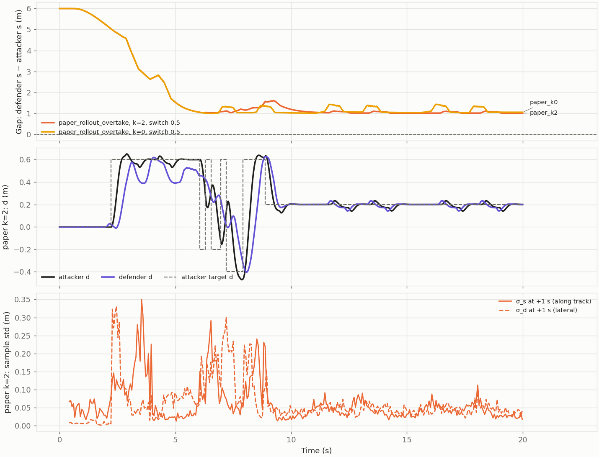
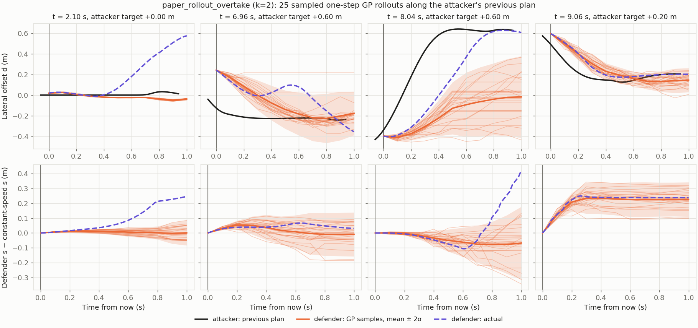

# paper_rollout_overtake 加上換目標成本（單場示範）

日期：2026-11-25；分支 `master`；基於 `534c18a`，含未提交修改。

## 改動

`RelativeOvertakingConfig.switch_weight`（m，類別預設 0）：候選的目標 d 與目前決策不同時，成本 J 加上這個固定值。這是最單純的作法，不看換多遠，也不看速度要求有沒有換。

- 程式在 `strategy/relative_overtaking.py`。所有繼承它的策略都可用，預設 0 時行為不變。
- main 只在 `PAPER_ROLLOUT_OVERTAKING_CONFIG` 設為 0.5。
  - main 的 `ellipse_sigma=0.0` 與 vehicle-1 指派 `paper_rollout_overtake`，是本次之前已在 main 改好的設定，沿用不動。

### 權重 0.5 的依據

[switch_gain.py](switch_gain.py)（[結果](switch_gain.json)）：不加換目標成本、跑前 10 s，看每次換目標比「維持原目標的最佳候選」省下多少成本。

| 設定 | 換目標次數 | 省下成本的 25／50／75／90 百分位 | 原目標全部不可行 |
| --- | ---: | --- | ---: |
| k=2 | 72 | 0.20／0.41／0.70／1.01 m | 0 次 |
| k=0 | 25 | 0.38／0.62／1.09／1.50 m | 0 次 |

0.5 m 約為 k=2 的中位數：省下不到 0.5 m 的換目標會被擋下，更大的仍可換。這個值只依這次觀察選定，沒有掃描其他值。

## 單場示範

- 命令：`python reports/experiments/2026-11-25_paper_switch_cost/demo_switch.py`。
- 場景、指標、圖都沿用 [paper_rollout_overtake 示範](../2026-11-25_paper_rollout_overtake/README.md)：rear 7、front（defend）6 m/s，相距 6 m，靜止起步，20 s。
- 只重跑 k=2、k=0 兩個設定，都加 switch_weight=0.5。「之前」欄取自該示範的 summary.json。
- 輸出：[summary.json](summary.json)、[demo_switch.log](demo_switch.log) 與兩張圖。

| 指標（閉迴路） | k=2 之前 | k=2 加成本 | k=0 之前 | k=0 加成本 | relative_overtake |
| --- | ---: | ---: | ---: | ---: | ---: |
| 首次領先 >0.6 m | 無 | 無 | 7.54 s | **無** | 7.58 s |
| 期末車距 | +0.67 m | +1.01 m | −18.41 m | +1.05 m | −18.41 m |
| 最小車距 | +0.38 m | +1.01 m | – | +0.99 m | – |
| 碰撞重疊步數 | 122 | **0** | 15 | **0** | 21 |
| 換目標次數（334 次決策） | 184 | **8** | 25 | **1** | 12 |
| 領先前可行候選（最多 28） | 19.7 | 25.2 | 23.3 | 26.8 | 23.7 |
| 每次決策耗時：平均 | 792 ms | 842 ms | 342 ms | 790 ms | 97 ms |

決策時的前車預測（GP 啟用的決策，t ≥ 0.5 s）：

| | k=2 之前 | k=2 加成本 | k=0 之前 | k=0 加成本 |
| --- | ---: | ---: | ---: | ---: |
| d 的 MAE：+0.5／+1 s | 0.130／0.250 m | 0.061／0.109 m | 0.083／0.155 m | 0.039／0.075 m |
| d 的 ±2σ 涵蓋：+0.5／+1 s | 64／57% | 84／79% | 72／58% | 82／83% |
| s 的 ±2σ 涵蓋：+0.5／+1 s | 82／80% | 90／85% | 74／72% | 88／87% |
| +1 s 的 σ_d 中位數 | 0.146 m | 0.046 m | 0.048 m | 0.070 m |

- k=0 加成本後的決策時刻，多數在跟車階段；之前的 k=0 在 7.5 s 超車後 GP 退回，可比的時刻不同。
- k=0 加成本後，中途超出範圍的樣本占 36.5%，多數是前車 d（2458 次）；k=2 為 15.2%。

時間序列（k=2）：
- 約 9 s 前，攻方還在左右試了幾次（換目標 8 次）。
- 約 9 s 起，攻方停在 d≈0.2 m，前車也對齊到 0.2 m，兩車相距約 1 m。之後到 20 s 都沒有再換目標。
- k=0 加成本只換過 1 次目標，車距曲線同樣停在約 1 m。

## 結論與限制

- 換目標成本幾乎消除了來回切換：k=2 由 184 次降到 8 次。碰撞也降到 0。
- 閉迴路的前車預測明顯變好：k=2 在 +1 s 的 d 涵蓋由 57% 升到 79%，σ_d 中位數由 0.146 降到 0.046 m。
  - 仍低於離線多步評估的 98.6%、0.013 m（[離線多步](../2026-11-25_paper_multistep_offline/README.md)）。
- **不利結果：兩個設定都不再超車**，停在前車正後方約 1 m。
  - 原本會超車的 k=0 也失去超車。
- 限制：單一場景、單一種子；權重只試了 0.5；多場成對評估尚未量測。

待驗證的分析：
- 前車會對齊攻方，GP 也學到這個阻擋反應。預測時域只有 1 s 時，往旁邊換目標在預測裡可能省不到 0.5 m，所以攻方一直留在後方。
- 尚未記錄停住階段各候選的成本差。

## 權重 0.3 與 0.5 的差別（main 預設場景）

main 之後改為 `switch_weight=0.3` 後會超車。

### 設定

[why_switch.py](why_switch.py) 直接呼叫 `main.run_simulation`，只把畫面換成假物件，並記錄攻方每次決策的所有候選成本（[比對結果](why_switch.json)）。

- 場景：main 預設。vehicle-1 7 m/s、vehicle-2 6 m/s，相距 4 m，21 s，k=0。
- 另以 0.3 跑上面的 6 m 示範場景，看是否不只在預設場景成立。

| 場景與權重 | 首次領先 >0.6 m | 換目標次數 | main 摘要的碰撞 |
| --- | ---: | ---: | --- |
| 預設，0 | 6.96 s | 30 | 有 |
| 預設，0.3 | 7.44 s | 18 | 有 |
| 預設，0.5 | 無 | 1 | 無 |
| 示範（相距 6 m），0.3 | 11.94 s | 36 | 有 |

- 碰撞只取 main 的摘要（有或無），本次沒有記錄步數。
- 「省下的成本」＝維持原目標的最佳候選，減去換到其他目標的最佳候選，都不含換目標成本。成本小於權重時就不換。

### 結果

- **0.5 為什麼停住**：2.22 s 換到 +0.6 m 之後，任何時刻換目標省下的成本最多只有：
  - 2.3～6 s：0.37 m。
  - 6～10 s：0.43 m。
  - 10～21 s：0.43 m。
  - 全部低於 0.5，所以之後一次都沒有換。
- **0.3 的分歧點**：與 0.5 的第一次分歧在 2.10 s。換到 +0.6 m 可省 0.345 m，大於 0.3、小於 0.5。之後 3.36 s 與 4.80 s 的換目標也只省 0.30～0.41 m。
- **0.3 怎麼超過的**：
  - 4.80～5.82 s，車距由 1.2 縮到 0.6 m，換目標可省的成本升到 0.5～1.7 m。攻方幾乎每次決策都在 −0.6 與 +0.6 m 之間來回，共 16 次。
  - 這段期間前車往負側移動，5.94 s 起約在 d≈−0.03～−0.21 m。
  - 攻方從 5.82 s 起固定在 +0.6 m，7.20 s 車距轉負，7.44 s 領先超過 0.6 m。
  - 這段時間 GP 推演預測前車 +1 s 的 d 約為 0，σ_d 0.007～0.14 m。

### 結論與限制

- 0.3 能超車，是因為它讓 0.3～0.43 m 這一級的換目標通過，0.5 則全部擋下。
- 超車前仍有約 1 s 的連續換邊，而且有碰撞；0.3 並沒有消除來回切換。
- 同一場景不加成本（0）也會超車：6.96 s 超車、換目標 30 次。
- 每個設定都只跑一次。

待驗證的分析：
- 超車前的連續換邊，可能像假動作一樣把前車引到負側，攻方才從 +0.6 m 通過。這是由前車 d 的變化推測，沒有直接測試。

## 進度權重 2 加換目標成本 0.3（main 目前的設定）

main 之後把④ `progress_weight` 改為 2.0，換目標成本 0.3、k=0 不變。仍用 `why_switch.py` 跑 main 預設場景，這次也記錄碰撞步數。

| 設定（預設場景，相距 4 m） | 首次領先 >0.6 m | 換目標次數 | 碰撞重疊步數 |
| --- | ---: | ---: | ---: |
| 進度 1、換目標 0.3（上一節） | 7.44 s | 18 | 有（未記步數） |
| **進度 2、換目標 0.3（目前）** | 8.16 s | 22 | 15 |
| 進度 2、換目標 0.5 | 11.16 s | 20 | 12 |
| 進度 1、換目標 0.15、安全 5 | 8.16 s | 22 | 15 |
| 示範場景（相距 6 m），進度 2、換目標 0.3 | 11.10 s | 22 | 16 |

### 結果

- **進度權重 ×2 等於把其他成本減半**：J＝2·gap_T＋safety＋switch 與 gap_T＋safety/2＋switch/2 的排序完全相同。
  - 實測：「進度 2、換目標 0.3」與「進度 1、換目標 0.15、安全 5」的 350 次決策逐一相同。
  - 所以目前設定實際上是換目標門檻 0.15 m、安全距離成本減半。
- 進度 2 時，即使換目標成本 0.5（相當於 0.25），預設場景也會超車；上一節進度 1、0.5 會停住。
- **超車過程與上一節相同**：
  - 先在 3.36～4.50 s 小幅調整幾次。
  - 4.56～5.16 s 車距由 1.15 縮到 0.72 m，連續換邊 11 次，在 −0.6 與 +0.6 m 之間來回。
  - 5.16 s 起攻方固定在 −0.6 m；前車約在 d≈−0.05 m，攻方從旁邊通過，8.16 s 領先超過 0.6 m。
- 不利結果：每次超車都有碰撞，12～16 步；超車前都有連續換邊。

### 限制

- 每個設定只跑一次，只有兩個場景。
- ④ 的 `progress_weight` 是 relative_overtake、interaction_overtake、rollout_overtake 共用的。改成 2 之後，這些策略被指派時的行為也會改變。

## 驗證

- 新增 1 項測試（`tests/test_relative_overtaking.py`）：
  - 其他目標的成本固定多 0.5，同目標不變。
  - 成本項與決策說明都多出 switch。
  - 預設 0 時不變；負值報錯。
- [全套測試](unittest.log)：471 項，2 項失敗，與基線同名（`test_no_defense_for_ahead_alongside_far_or_unspecified_vehicle` 的兩個子案例）。
- 既有策略行為不變（[equivalence.log](equivalence.log)）：
  - 因為 main 的 vehicle-1 預設已改成 paper_rollout_overtake，比對時在記憶體中把它改回 rollout_overtake，不改檔案（[equivalence_after.log](equivalence_after.log)）。
  - 再與 534c18a 的基準比對，11 個場景全部相同。
