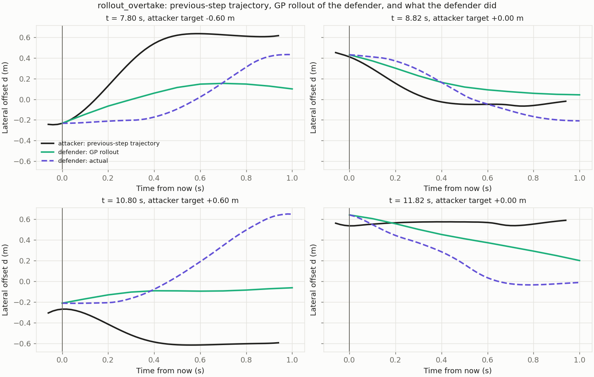
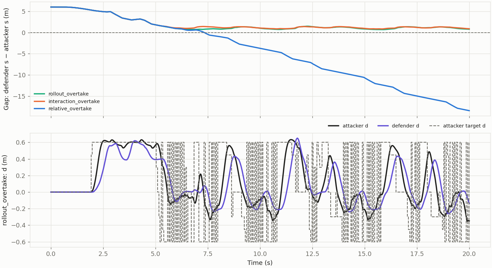

# rollout_overtake：沿自車上一步軌跡推演對手（單場示範）

日期：2026-11-25；分支 `master`；基於 `015134b`，含未提交修改。

## 策略

[strategy/rollout_overtaking.py](../../../strategy/rollout_overtaking.py)，繼承 interaction_overtake。每次決策：

1. **取上一步軌跡**：上一次決策選中候選的預測軌跡，不從目前狀態重算。
   - 時間對齊到現在：取 t − t_prev 起的部分。
   - 末端不足時，以末端速度沿賽道、維持末端 d 延伸。
2. **沿軌跡推演對手**：每 0.1 s 一個節點（0～0.9 s）查一次 v2。
   - 自車狀態取上一步軌跡在對應時刻的值；對手 s 定速前進，d 用推演值。
   - 特徵歷史欄位：早於現在用實際紀錄，晚於現在用上一步軌跡（自車）或推演值（對手）。
   - d_target＝上一步選中的目標。
   - 每步增量＝GP 的 0.5 s Δd × 0.1／0.5；σ 以相同比例累加。
3. **選候選**：所有候選共用這條對手軌跡（平均與 ±2σ 邊界）。候選、成本與避撞責任同 interaction_overtake。不做選後複查。
4. **退回**：
   - 沒有上一步軌跡、第一個節點歷史不足或超出 GP 訓練範圍時，退回定速等 d。
   - 後段節點超出範圍時，其餘時段維持最後的 d。

設定在 `main.py` ⑤-3 `ROLLOUT_OVERTAKING_CONFIG`（rollout_step=0.1、band_sigma=2.0），模型與 interaction_overtake 共用（目前 v2）。

## 單場示範設定

- 命令：`python reports/experiments/2026-11-25_rollout_overtake/demo.py`（輸出 [demo.log](demo.log)、[summary.json](summary.json)）。
- 場景：main 的 `INTERACTION_VEHICLE_SPECS`。
  - 圓角矩形；rear 7 m/s、front（defend）6 m/s；起點相距 6 m，靜止起步，20 s。
- 三個策略在同一場比較：候選（7 個訓練過的目標）、橫移 3.0 m、成本都相同。
  - 目前 main 的 deviation_weight=0.0、決策週期 0.05 s（實際每 3 步一次）。

## 量化結果（單一場景，不代表成功率）

| 指標 | rollout_overtake | interaction_overtake（各候選） | relative_overtake |
| --- | ---: | ---: | ---: |
| 首次領先 >0.6 m | 無 | 無 | 7.58 s |
| 期末車距（前車 s − 攻方 s） | +0.78 m | +0.89 m | −18.39 m |
| 碰撞重疊步數 | 0 | 0 | 16 |
| 換目標次數（334 次決策） | 146 | 99 | 16 |
| GP 啟用比例 | 97.6% | 97.9% | – |
| 對手 d 預測 MAE：+0.5 s／+1.0 s | 0.147／0.193 m | 0.109／0.237 m | – |
| 整場耗時／攻方決策數 | 339 ms | 275 ms | 171 ms |

- rollout_overtake 的退回與維持：
  - 整段退回 8 次：沒有上一步軌跡 1 次、歷史不足 6 次、第一節點前車 d 超出範圍 1 次。
  - 後段維持 23 次：後車−前車速度 19 次、後車 d 4 次。
- 預測誤差用決策時的 GP 軌跡，比對模擬中前車實際 0.5／1.0 s 後的 d。

快照圖選前車 1 s 內橫移最大的 4 個決策時刻（間隔 ≥1 s）。

- t=7.80 s 與 10.80 s：上一步軌跡往一側，這一步卻選了另一側（目標 −0.6 與 +0.6 m）。
- 依上一步軌跡推出的對手位置與實際差距大：防守車跟著攻方新的動作移動。

## 不利結果與限制

- 這個場景中 rollout_overtake 沒有超車：換目標 146 次，主要在 ±0.6 m 之間來回，與 v2 interaction_overtake 的現象相同但更頻繁。
- 0.5 s 的預測誤差比單次查詢大（0.147 對 0.109 m），1.0 s 較小（0.193 對 0.237 m）。
- 對手軌跡依上一步軌跡推演，這一步換成別的候選時，預測與實際動作錯位（設計上不複查）。
- 每步增量用 0.5 s 預測換算，假設 0.5 s 內橫移速度平均，未經驗證。
- 單一場景、單一防守設定；未做多場成對評估。

待驗證的分析：

- 攻方換邊後，防守車立刻對新動作反應，而對手軌跡仍反映舊計畫，可能讓下一步又選回另一側，形成來回切換。
- 若要比較是否改善，需要多場成對評估。

## 驗證

- [相關測試](../../../tests/test_rollout_overtaking.py) 9 項通過：
  - 固定 μ 時 d(0.5)=d0+μ、d(1.0)=d0+2μ。
  - 送進 GP 的自車 d 等於上一步軌跡在 t − t_prev + τ 的值、d_target＝上一步目標，歷史欄位跨越現在時接上實際紀錄。
  - 軌跡末端延伸；沒有上一步軌跡、第一節點超出範圍時退回；後段超出範圍時維持。
  - 步長與時域都是 0.5 s 時，與 interaction_overtake 單次查詢的軌跡相同。
  - 無模型時與 relative_overtake 決策相同；設定驗證與工廠註冊。
- [完整測試](unittest.log)：449 項，2 項失敗，與基線同名（防守被動場景）。
- 既有策略行為不變：在 HEAD 暫時工作樹與目前工作區各跑 [verify_equivalence.py](../2026-11-24_refactor_equivalence/verify_equivalence.py)，比對 11 個場景（[equivalence.log](equivalence.log)）。
  - 6 個完全相同。
  - 5 個只有終端機輸出的雜湊不同：載入互動 GP 時印出的訊息改成分行。
  - 各車軌跡與最終畫面雜湊全部相同。
