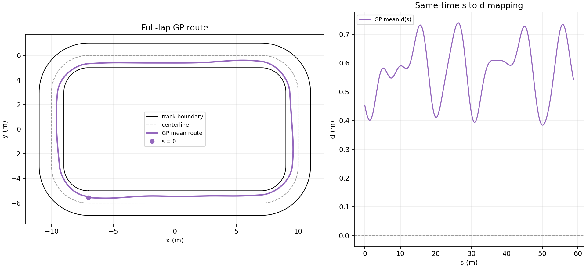

# 每週研究進度摘要

最新有實質進展的一週置頂；同週同主題合併更新，每週保留 3～5 點。
完整歷史見 [11/11 長版封存](archive/2026-11-11_research_log_full.md)，操作與一般變更見 [README](../README.md)／[CHANGELOG](../CHANGELOG.md)。

## 2026-11-16～2026-11-22｜GP 完整流程已串接，並已實際跑過預測

日期：2026-11-16；分支：`master`；基於 `bf1566e9edc403a4385e930976e723480a6702d4`，含未提交修改。

- **資料收集 → 訓練 → 模型預測已串接：**使用者明確確認整套流程已完成，並已實際跑過預測；目前將訓練好的 s→d GP 載入進攻策略，預測對手路線後用於候選碰撞篩選。
  既有執行紀錄顯示 21 秒、1050 步場景完成且未偵測到實際重疊，僅支持此單一場景可執行，不代表超車成功率或安全性改善。（[訓練評估](experiments/2026-11-11_baseline/gp_current_sd/report.json)、[評估圖](experiments/2026-11-11_baseline/gp_current_sd/evaluation.png)、[預測執行紀錄](experiments/2026-11-16_gp_attack/smoke_summary.json)）

- **已有路線圖與預測畫面：**整圈圖保留 1000 個 GP 平均路線取樣點，預測畫面來自已執行的 2 秒、100 幀更新流程，顯示策略實際使用的對手預測。
  整圈線是模型平均路線，並非實際行駛軌跡；預測畫面由 Agg 後端保存，未人工操作互動 GUI。（[圖表說明](experiments/2026-11-16_gp_visualization/README.md)、[畫面來源](experiments/2026-11-16_gp_visualization/live_summary.json)）

- **限制與既有測試狀態：**先前完整測試紀錄為 281 項、1 個既有防守整合初始化錯誤；預測起步仍可能不連續，全部候選被剔除時沿用原路徑。
  完整模型與原始訓練資料仍只在本機；本次僅整理文字並推送已有程式、圖表與紀錄，沒有重跑測試、預測、訓練或產圖。（[既有測試日誌](experiments/2026-11-16_gp_visualization/full_tests.log)、[重現需求](experiments/2026-11-16_gp_attack/README.md#重現與缺少的本機資料)）

| 整圈 GP 平均路線（非實際軌跡） | 模擬中的對手 GP 預測（Agg 畫面） |
| --- | --- |
|  |  |

## 2026-11-09～2026-11-15｜11/11 紀錄整理

收錄版本：`master`／`bf1566e`；以下是 11/11 既有紀錄與結果，非本次重新實驗，歷史 GP 實驗的程式版本未記錄。

- **相對進度超車與碰撞條件：**新增以預測終點有號間距選路徑的策略，超車後仍保留比較對象，並以可調尺寸的矩形剔除預測碰撞候選。
  超車成功率與碰撞率**尚未量測**；同輪固定對手預測下，成本排序與最大自車進度相同，且全部候選被剔除時仍沿用舊路徑，不能保證無碰撞。（[方法與限制](archive/2026-11-11_research_log_full.md#成本限制與對手預測的實作摘要)）

- **同時刻 s→d 模型：**資料欄位與 GP 流程支援同時刻答案，既有測試集 201 筆的 GP MAE／RMSE 為 **0.0391／0.1177 m**，訓練平均值基準為 0.1017／0.1657 m。
  評估只有一個測試 episode，最大絕對誤差仍達 0.8331 m；這是同時刻路線對應，非未來反應預測，GP 尚未接入策略。（[報告](experiments/2026-11-11_baseline/gp_current_sd/report.json)、[誤差案例](experiments/2026-11-11_baseline/summary.json)）

- **未來橫向位移預測：**整理舊四輸入 GP 結果，0.02 s 預測的 MAE 為 **0.00732 m**（零值基準 0.00850 m），1 s 預測為 **0.12062 m**（零值基準 0.10863 m）。
  1 s 模型未優於零值基準；兩組各僅一個測試 episode，答案時間與資料量不同，不能視為同一受控改善比較。（[0.02 s 報告](experiments/2026-11-11_baseline/gp_future_0p02s/report.json)、[1 s 報告](experiments/2026-11-11_baseline/gp_future_1s/report.json)）

- **驗證範圍與可重現性：**11/11 完整測試輸出為 **264 項、1 個初始化錯誤**，原因是防守整合場景的 6 m 過渡長度超過 4 m 參考路徑，該類別的測試方法未執行。
  三組既有 GP 的 1352 筆預測誤差核對通過，但這不代表策略效果已驗證；完整原始資料與模型仍只在本機，Git 內小型證據不足以重訓歷史模型。（[測試日誌](experiments/2026-11-11_push_review/unittest.log)、[證據核對](experiments/2026-11-11_push_review/evidence_verification.log)）
