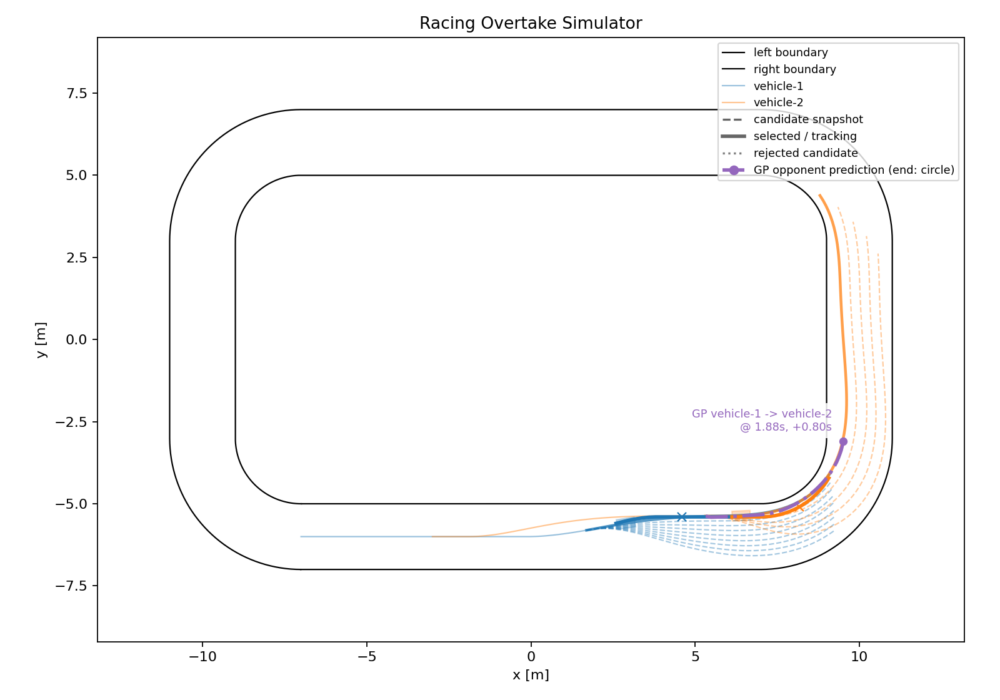

# 每週研究進度摘要

最新有實質進展的一週置頂；同週同主題合併更新，每週保留 3～5 點。
完整歷史見 [11/11 長版封存](archive/2026-11-11_research_log_full.md)，操作與一般變更見 [README](../README.md)／[CHANGELOG](../CHANGELOG.md)。
固定設定與重現命令另見 [實驗參數紀錄](experiments/parameter_records/README.md)；參數快照不代表已執行或驗證結果。

11/17 本次提交收錄程式、測試與小型實驗證據，推送前 342 項測試全部通過（[日誌](experiments/2026-11-17_interaction_gp/push_unittest.log)）。
下文的「未提交／未推送」是量測當時的狀態；原始資料與模型仍僅在本機。

## 2026-11-23～2026-11-29｜互動歷史 GP、速度入成本、最晚碰撞退路、防守 bicycle 預測、避撞責任約束

日期：2026-11-23；分支 `master`；基於 `1d4a182`，含未提交修改，以及使用者先前已改的 `LOOKAHEAD_DISTANCE=1.0`。

- **互動歷史 GP（11/24，使用者要求：讓 probe_follow 後車試探並學習防守反應，輸入含互動歷史；基於 `901ae7f`，含未提交修改）：**
  - 輸入為雙車 d、車頭角誤差、車速、gap、前車曲率，加上過去 0.4 s 切兩段的雙車 Δd，可選加後車當下目標 d_target；答案為前車 0.5 s 後的 Δd。收集時每場隨機試探順序、幅度與保持時間。
  - 圓角矩形 20 場、2840 筆，同一切分的測試 MAE：(a) 無歷史 8 維 **0.102 m**、(b) 加歷史 **0.038 m**、(c) 再加 d_target **0.030 m**；固定 Δd=0 為 0.117 m。4 場測試每場都是 c<b<a。
  - 限制：±2σ 涵蓋率 83～89%，未校準；(c) 最大誤差 0.219 m（約 6.8σ）。單一地圖、單一防守配置，只有 4 場測試；尚未接入規劃器。（[方法、結果與限制](experiments/2026-11-24_history_gp/README.md)）
  - **涵蓋率診斷（使用者問是否因資料太少）：**
    - 驗證整體 96.7%，但不足集中在 ±0.6 m 試探：驗證 62.5%（16 筆）、測試 57.1%；0.3／0.45 m 為 94～97%。此分析由使用者提供（ChatGPT），Codex 重算一致。
    - 只增加同類資料能降 MAE（每場 5→15 s：0.055→0.030 m），涵蓋率仍停在 77～84%；20 場 5 折交叉驗證合併 91.4%。（[診斷](experiments/2026-11-24_coverage_diagnosis/README.md)）
  - **前車速度 × ±0.6 m 新場次（使用者轉述 ChatGPT 建議並核准；不做 σ 校準）：**
    - 16 場 × 30 s，前車 3～7 m/s 分四區間。
    - 固定 0.6 m 時，現有模型在 3～4 m/s 的 4 場涵蓋率 74～79%，4 m/s 以上 12 場 51～72%。4 m/s 以上沒有再隨速度一路變差。
    - 加入新訓練 8 場的完整 30 s 重訓後，新測試 8 場的 0.6 m MAE 從 0.054～0.062 降到 0.039～0.041 m，每場都下降；涵蓋率 77～80%，仍未達 95%。
    - 同 8 場只用前 15 s 時，MAE 幾乎沒變。
    - 不利結果：舊保留場的 0.3／0.45 m MAE 0.017→0.023 m，舊保留場整體 ±2σ 平均寬度 +39%。單一 seed 與切分。（[方法、結果與限制](experiments/2026-11-24_speed_amplitude_probe/README.md)）

- **進攻速度入成本與最晚碰撞退路（使用者要求，理由未說明）：**
  - `relative_overtake` 改為 9 條橫向 × 巡航／前車速度／−1／−4 m/s 的全組合。
  - 成本 = 終點相對間距 + 10 × 安全距離項（Frenet 矩形間隙小於 0.5 m 時，依不足量平方懲罰）。
  - 全部不可行時，改選最晚碰撞的候選，同時間選低速。
  - 預設場景 21 s：碰撞步數 **36→2**，no_feasible **18→1**；但進攻車**未完成超車**（最終 s 為 185.0 對 186.1 m，修改前 222.4 對 192.8 m），左右目標切換次數 27→167。
  - 安全項設為 0、或防守改回幾何預測的對照組也都沒有超車。修改前的超車發生在 no_feasible 期間，並伴隨碰撞。
  - 以上只是單一場景，不能代表成功率。（[設定、結果與限制](experiments/2026-11-23_speed_cost_fallback_bicycle_defense/README.md)）
- **偏離中心線成本（使用者要求，理由未說明）：**
  - 進攻成本加入 `w×mean(d²)`，防守 J_race 加入 `w×Σd²`，main 設 w=1.0，尚未調參。
  - 在使用者後續參數下（碰撞框 0.6×0.4 m、7 個候選偏移、防守 `gap<0`）：仍完成超車；平均 |d| 攻／守 **0.52／0.52→0.41／0.13 m**，碰撞步數 30→20，但目標切換 8／6→45／29，防守最終 s 少約 8 m。
  - 單一場景。（[結果與限制](experiments/2026-11-23_centerline_deviation_cost/README.md)）
  - 使用者已提及的下一步：以最小曲率計算全域賽車線，並把所有車改為相對賽車線偏移，尚未實作。
- **防守自車改用 bicycle rollout：** 只替換自車預測；對齊成本仍用後車當下的 d，碰撞條件維持關閉。單獨效果尚未分離量測。
- **避撞責任約束（使用者要求依論文截圖評估並實作，選定圓形距離＋硬約束；理由未說明）：**
  - 約束為 `‖Δc‖²−r_col²−ℓ(Δs)≥0`：後車負責，並排時兩車都負責，領先者放寬。攻方以此取代矩形剔除；守方原本沒有碰撞條件，改為對所有車逐對檢查。
  - 參數 r_col=0.6 m，a=5、b=4.5 沿用論文，未調參。截圖公式的正負號與圖、內文矛盾，依圖實作。
  - 預設場景單次量測：關閉時與修改前完全相同；開啟時 SAT 碰撞步數 **78→0**、攻方 no_feasible 28→0，攻方仍完成超車，首次領先 4.34→3.62 s。
  - 日誌顯示，守方在攻方仍落後 2～3 m 時，就因預測會並排而被剔除阻擋候選，並在 2.96 s 被迫換到另一側。
  - 限制：在論文參數下，前後車的要求只在 |Δs|≈0.3～0.6 m 差較多；圓形與矩形不一致，0 碰撞不是保證；單一場景。
  - **後續調參（使用者要求：只調參數，讓守方不主動避讓，只有完全並排時前車才負責）：** main 改為 a=5→**40**（前車領先超過約 0.1 m 就免責），守方檢查時長 1.5→**0.2 s**。
    - 只改 a 時，守方仍在攻方落後 2.9 m 時就被剔除候選，因為它預測攻方會追到並排。所以檢查時長也要縮短。
    - 調整後，守方第一次被剔除時，實際間距為 0.17 m。攻方仍完成超車（4.34 s），但 SAT 碰撞步數 **0→22**，攻／守 no_feasible 7／2。
    - 碰撞始於攻方在 0.7～0.9 m 後方橫越守方，早於守方第一次被剔除。（[方法、結果與限制](experiments/2026-11-23_collision_responsibility/README.md)）
  - **後車硬限制、前車成本懲罰（使用者提議並要求實作，想知道能否改善守方讓路）：**
    - 新增 `leader_soft`：決策當下在前的車不剔除，改計 `w×mean max(0,r_col−‖Δc‖)²`。
    - 量測前，使用者已把守方決策週期與檢查時長都改為 0.1 s。此設定的基準為碰撞 37 步、7.12 s 超車。
    - w=0：碰撞 47 步，超車時間相同。w>0（檢查時長 0.1／1.0 s，w=100～1000）：守方維持阻擋更久，但超車延後或未發生，碰撞 **53～179 步**。
    - 單一場景下沒有改善。（[結果與限制](experiments/2026-11-23_responsibility_leader_penalty/README.md)）
  - **重疊責任規則（使用者要求：開始重疊時兩車都負責，第一次脫離後只剩後車）：**
    - 新增 `overlap_rule`：依決策當下判定，縱向重疊中（|Δs| < 0.6 m）兩車都要保持 r_col，自車完全在前就不負責；不套 ℓ。main 已改用此模式。
    - 守方被限制時的實際間距都在 −0.60～+0.32 m，不再因預測被超越而提前受限。
    - 守方檢查 0.1 s（使用者設定）：碰撞 51→**73 步**，超車 7.12→10.40 s。改成 1.0 s 的對照：碰撞 **26 步**，5.52 s 超車。
    - 重疊剛開始時橫向常只有約 0.4 m（小於 r_col），守方一取得責任就沒有可行路徑。單一場景。（[結果與限制](experiments/2026-11-23_overlap_responsibility/README.md)）
- **決策週期容差與橫移接續修正（11/24，使用者決定修正，理由未說明）：**
  - 決策週期判斷加入 1e-9 浮點容差：0.1 s 週期由 5／6 步交替改為每 5 步準時，6 s 內 55→60 次。
  - defend 與規則式 overtake 完成橫移後改為接續的等偏移線，同一目標保持超過一圈時不再重播過渡。
  - 預設 relative＋defend 場景（0.05 s 週期）6 s 與 21 s 結果都不變，本週先前的量測仍可比較。
  - cost_overtake＋defend 6 s 的碰撞步數 13→0，來自決策時間點改變；單一場景，不代表更安全。
  - 使用 0.1 s 週期的 progress、cost_overtake 結果不可直接與修正前比較。（[方法、結果與限制](experiments/2026-11-24_decision_period_and_maneuver_fix/README.md)）
- **計算量與驗證：**
  - 速度入成本後，進攻每次決策 76→**255 ms**、防守 0.8→31 ms（實際週期 0.06 s，都無法即時運算）。責任約束開啟後，以當下 main 設定量得攻方 103→78 ms、守方 44→70 ms。
  - 11/24 快取賽道幾何（結果逐位元不變）：預設場景每次決策攻方 162.6→**106.9 ms**、守方 47.0→**31.0 ms**，仍無法即時運算。
    - 另新增 `--replay` 先算後播，只改顯示方式。
    - （[量測](experiments/2026-11-24_replay_and_track_cache/README.md)）
  - 11/23 測試為 401 項（Agg），3 項失敗，與先前紀錄同名；責任約束相關的 36 項全部通過（[日誌](experiments/2026-11-23_overlap_responsibility/unittest.log)）。
  - 11/24 最新為 413 項，仍是同名的 3 項失敗（[日誌](experiments/2026-11-24_decision_period_and_maneuver_fix/unittest.log)）。
  - 程式與證據尚未 commit／push。

## 2026-11-16～2026-11-22｜試探跟車、GP 預測與外部地圖循跡

日期：2026-11-16；分支：`master`；基於 `bf1566e9edc403a4385e930976e723480a6702d4`，含未提交修改。
以下 GP 項目沿用既有紀錄；本次外部地圖工作基於 `1955cacea110dc57ef6dfeea293a521e549f1b8e`，含未提交修改。
11/17 的速度要求、候選比較與試探跟車基於 `6dc4a2b9cb76c5f83810efadeeb3a0eca0d75968`，含未提交修改。
11/18 額外速度候選基於 `de3581a06604976980aa6efa36c1cf61b84fa84c`，含未提交修改。
11/18 八輸入 GP 亦基於 `de3581a06604976980aa6efa36c1cf61b84fa84c`，含當下未提交參數與本次訓練擴充；設定與程式雜湊另存於該實驗證據。

- **目標車距與左右試探已實作**，`probe_follow` 以目標相對進度成本選速度；先前加入巡航候選的固定 3 m 初距、10／12 m/s 案例，15 s 末距由 3.684 降至 1.878 m。
  11/18 依使用者要求，在 relative_overtake 增加前車 −4 m/s 候選；固定直線案例的原候選都預測碰撞，新候選可行且預測／執行一致，但當下 main 的 21 s 前後比較都未選低速，尚不能支持持續無碰撞跟車。（[設定與限制](experiments/2026-11-18_extra_speed_candidates/README.md)、[比較數據](experiments/2026-11-18_extra_speed_candidates/summary.json)）
  依使用者希望偏出去待久一點的要求，本次固定階段的橫向目標，首次到達後保持 2 s，該側不可行時可中止；當下 1 m 初距的 15 s 圓角場景由 9 段短促左側目標，變為左、右、左三段，首次到達後保持目標 2.06、2.08、2.02 s，未偵測碰撞或 no_feasible_path。
  完整 337 項測試通過；保持的是目標，彎道實際偏移仍有波動，起步落後及有限視野限制仍存在，GP 互動模型後續離線結果見下項。（[本次方法與限制](experiments/2026-11-17_probe_following/README.md#1117-試探目標保持)、[保持量測](experiments/2026-11-17_probe_following/hold_after_summary.json)、[前後比較圖](experiments/2026-11-17_probe_following/hold_comparison.png)、[本次測試](experiments/2026-11-17_probe_following/hold_unittest.log)、[先前巡航候選比較](experiments/2026-11-17_probe_following/cruise_comparison_summary.json)）

- **GP 路線預測與互動模型：**11/18 依使用者要求，沿用當下進攻／防守參數並加入已執行候選 d_target，完成八輸入、0.5 s 位移 GP；20 場各 25 s 共 4026 筆，12 場全部 2309 筆擬合，4 場驗證 MAE 0.075690 m、4 場測試 MAE／RMSE **0.085968／0.130142 m**，測試零位移基準為 0.351976／0.468345 m。（[方法、設定與結果](experiments/2026-11-18_action_gp/README.md)、[報告](experiments/2026-11-18_action_gp/report.json)、[圖表](experiments/2026-11-18_action_gp/evaluation.png)）
  全部標籤、當下動作、切分與模型重讀核對通過，但 54.20% 樣本在後續標籤窗內改過目標，尚未接入規劃器或驗證未執行候選的反事實反應，最大測試誤差仍為 0.640401 m，原始資料與模型僅在本機。（[核對](experiments/2026-11-18_action_gp/audit.json)）
  先前七輸入試探場景與本次策略、速度、碰撞矩形及資料量不同，不能直接作受控改善比較；既有單一 s→d 的策略接入與紫色軌跡顯示另有歷史證據。（[11/17 七輸入結果](experiments/2026-11-17_interaction_gp/README.md)、[11/16 s→d 接入](experiments/2026-11-16_gp_attack/README.md)、[整圈與即時圖](experiments/2026-11-16_gp_visualization/README.md)）

- **外部地圖接入與單車循跡：**依使用者要求加入下載的中心線 CSV 與 PNG／YAML 顯示，沿用 Pure Pursuit；Oschersleben 以 5 m/s 目標速度完成兩圈，最大橫向誤差 **0.3647 m**、RMS **0.0900 m**，逐步車身角點越界樣本為 **0**。
  依使用者要求再縮減為原架構的單一 `TRACK_NAME` 選項，撤回單車入口與資料格式擴充；原有雙車配置在縮減後完成 21 秒執行，但有偵測到兩車碰撞，未驗證策略效果改善。（[單車歷史結果](experiments/2026-11-16_map_import/README.md)、[兩圈軌跡圖](experiments/2026-11-16_map_import/oschersleben/following.png)、[目前最小接入與限制](experiments/2026-11-16_map_minimal/README.md)）

- **換圖卡頓與背景快取：**先前量測顯示 PNG 重繪是新增卡頓主因；依使用者要求，本次僅改視覺化加入快取，圖元更新＋渲染平均由 **141.37 ms** 降為 **8.38 ms**，100 幀的完整重繪由 100 次降為 1 次，兩組最終狀態一致。
  後續查明 TkAgg 的 plt.pause 會經 show 再次排程完整重繪，已依使用者要求只修正快取分支的事件等待；先前 8.38 ms 未涵蓋此 GUI 路徑，本次真實 Tk 驗證又受 init.tcl 啟動錯誤阻擋，尚不能宣稱 GUI 改善倍率。（[瓶頸](experiments/2026-11-16_map_performance/README.md)、[快取量測](experiments/2026-11-16_background_cache/README.md)、[本次修正與限制](experiments/2026-11-16_tk_cache_fix/README.md)）
  以已提交版本另跑各一次 8 秒 Agg 比較，原圓角 GP／新圖每步含繪圖平均為 46.71／46.45 ms，沒有重現新圖大幅較慢；決策尖峰與視覺尺度差異已記錄，實際 GUI 額外差距仍未定位，本次僅新增未提交量測。（[修正後比較](experiments/2026-11-16_postfix_comparison/README.md)）

- **驗證與交接限制**，11/17 先前將兩項依賴圓角場景的舊測試固定選圖，當時模擬使用 Oschersleben 與 20／18 m/s 目標速度，Agg 下完成 21 秒執行；此為歷史設定，非本次追近診斷配置。
  GP 起步不連續與全部候選被剔除時沿用原決策的限制仍存在，完整模型、訓練原始資料、下載地圖及環境仍僅在本機，11/17 程式與小型證據尚未 commit／push。（[本次執行](experiments/2026-11-17_speed_requests/main_agg.log)、[重現需求](experiments/2026-11-16_map_import/README.md#git-與重現需求)、[GP 既有限制](experiments/2026-11-16_gp_attack/README.md#重現與缺少的本機資料)）

| 整圈 GP 平均路線（非實際軌跡） | 模擬中的對手 GP 預測（Agg 畫面） |
| --- | --- |
|  |  |

## 2026-11-09～2026-11-15｜11/11 紀錄整理

收錄版本：`master`／`bf1566e`；以下是 11/11 既有紀錄與結果，非本次重新實驗，歷史 GP 實驗的程式版本未記錄。

- **相對進度超車與碰撞條件：**新增以預測終點有號間距選路徑的策略，超車後仍保留比較對象，並以可調尺寸的矩形剔除預測碰撞候選。
  超車成功率與碰撞率**尚未量測**；同輪固定對手預測下，成本排序與最大自車進度相同，且全部候選被剔除時仍沿用舊路徑，不能保證無碰撞。（[方法與限制](archive/2026-11-11_research_log_full.md#成本限制與對手預測的實作摘要)）

- **同時刻 s→d 模型：**資料欄位與 GP 流程支援同時刻答案，既有測試集 201 筆的 GP MAE／RMSE 為 **0.0391／0.1177 m**，訓練平均值基準為 0.1017／0.1657 m。
  評估只有一個測試 episode，最大絕對誤差仍達 0.8331 m；這是同時刻路線對應，非未來反應預測，GP 尚未接入策略。（[報告](experiments/2026-11-11_baseline/gp_current_sd/report.json)、[誤差案例](experiments/2026-11-11_baseline/summary.json)）

- **未來橫向位移預測：**整理舊四輸入 GP 結果，0.02 s 預測的 MAE 為 **0.00732 m**（零值基準 0.00850 m），1 s 預測為 **0.12062 m**（零值基準 0.10863 m）。
  1 s 模型未優於零值基準；兩組各僅一個測試 episode，答案時間與資料量不同，不能視為同一受控改善比較。（[0.02 s 報告](experiments/2026-11-11_baseline/gp_future_0p02s/report.json)、[1 s 報告](experiments/2026-11-11_baseline/gp_future_1s/report.json)）

- **驗證範圍與可重現性：**11/11 完整測試輸出為 **264 項、1 個初始化錯誤**，原因是防守整合場景的 6 m 過渡長度超過 4 m 參考路徑，該類別的測試方法未執行。
  三組既有 GP 的 1352 筆預測誤差核對通過，但這不代表策略效果已驗證；完整原始資料與模型仍只在本機，Git 內小型證據不足以重訓歷史模型。（[測試日誌](experiments/2026-11-11_push_review/unittest.log)、[證據核對](experiments/2026-11-11_push_review/evidence_verification.log)）
